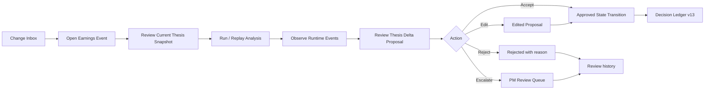
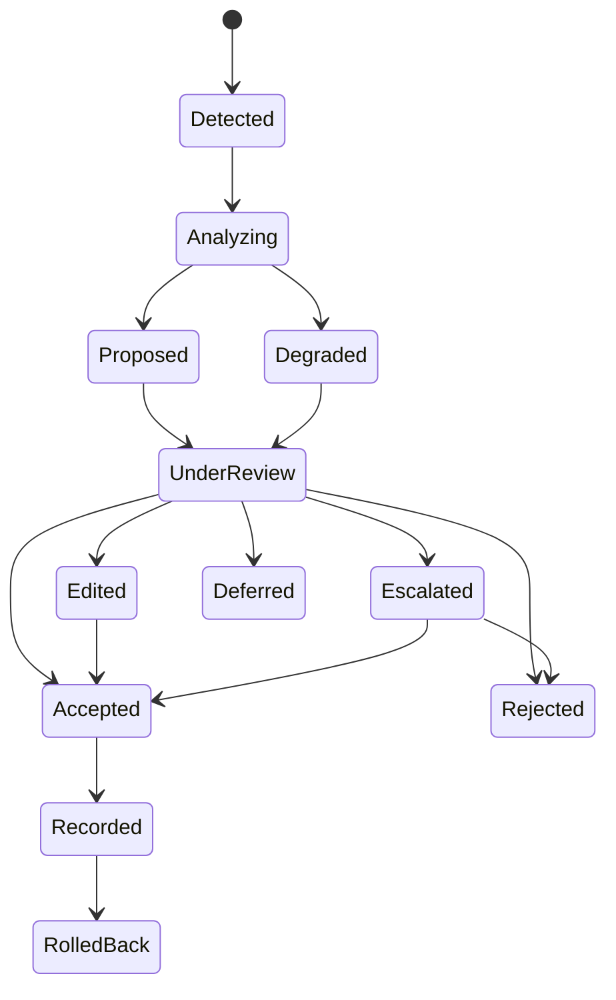

# Delphi 交互原型 PRD v0.2

**产品：Delphi — Earnings-to-Thesis**  
**目标：构建一个可用于 EFL 申请、投资人沟通和设计伙伴访谈的稳定交互原型**  
**状态：Build-ready**

---

## 1. 原型命题

### 1.1 用户问题

财报之后，团队通常能得到很多摘要，却仍需要手工回答：

- 哪些事实偏离了我们的预测？
- 哪条已批准的 thesis pillar 被加强、削弱或推翻？
- 哪些数字存在口径问题？
- 哪些风险或 open questions 需要重新打开？
- 谁决定接受这次观点变化？
- 以后如何还原当时的证据与判断？

### 1.2 原型承诺

> **In minutes, Delphi turns an earnings event into a cited, reviewable thesis delta—and records only what the team approves.**

### 1.3 原型成功的可观察证据

评审者必须能独立完成：

1. 在 Change Inbox 看到一个新的 earnings event；
2. 打开事件并查看来源与当前批准的 thesis；
3. 启动或重放分析；
4. 观察受边界控制的 runtime 进度；
5. 阅读 3–5 个结构化 Thesis Deltas；
6. 打开每项 evidence；
7. 对一项 delta 执行 Accept / Edit / Reject / Escalate；
8. 看到正式 thesis version 从 `v12` 变成 `v13`；
9. 在 Decision Ledger 中查看 state transition、批准者、来源与版本；
10. 打开 Privacy Receipt；
11. 触发或查看一次 degraded run。

---

## 2. 用户与情境

### 2.1 主用户：Fundamental Equity Analyst

- 负责 10–25 个 names；
- 有 Excel 模型、thesis 文档和定期 review；
- 财报季需要快速比较预期、事实和管理层措辞；
- 不愿把最终判断交给模型；
- 不愿重复录入多个 tracker。

### 2.2 次用户：PM / CIO

- 只想看到 material changes；
- 需要快速知道“against our view”；
- 需要区分事实、模型推断与团队批准；
- 需要保留责任和历史。

### 2.3 辅助用户：Head of Research / COO / CCO

- 关注一致性、权限、审计和数据边界；
- 不一定参与每项 delta review。

---

## 3. Demo 数据策略

### 3.1 默认 fixture

使用明确标记为 **Synthetic Demo Data** 的虚构公司：

```yaml
company: Archetype Systems
ticker: ARCT-DEMO
sector: AI infrastructure software
event: FY2026 Q2 earnings
case_id: case_arct_001
approved_thesis_version: 12
```

避免真实公司数据随时间变化、许可争议或投资观点被误解。

### 3.2 可选真实案例

可保留 AAPL 或其他公开公司历史 fixture，用于技术连续性；任何外部演示都应显示：

> Historical public-data demonstration. Not investment advice.

### 3.3 两个必备案例

1. **Successful / mixed outcome**  
   有多个支持与反驳点，最终部分接受、部分升级；
2. **Degraded case**  
   transcript 缺失或数字冲突，系统明确标记无法完成的部分。

---

## 4. 核心用户旅程



---

## 5. 信息架构

### 一级导航

1. **Change Inbox**
2. **Cases**
3. **Decision Ledger**
4. **Runs**
5. **Trust**
6. Settings（低优先级）

### 页面

| Route | 页面 | 原型优先级 |
|---|---|---|
| `/` | Change Inbox | P0 |
| `/cases/arct-demo` | Investment Case | P0 |
| `/deltas/delta-001` | Delta Review | P0 |
| `/ledger` | Decision Ledger | P0 |
| `/runs/run-001` | Run Observatory | P0 |
| `/trust/run-001` | Privacy Receipt | P1 |
| `/settings` | Workflow / firm overlay mock | P2 |

---

## 6. P0 功能

### 6.1 Change Inbox

展示：

- company / event；
- event time；
- workflow；
- materiality score；
- review status；
- number of proposed changes；
- degraded / evidence conflict badge；
- required reviewer；
- SLA / elapsed time。

交互：

- filter by `Needs review / Escalated / Approved / Degraded`；
- filter by company；
- sort by materiality / recency；
- click opens Delta Review；
- keyboard navigation optional。

### 6.2 Investment Case

展示：

- approved thesis summary；
- thesis pillars；
- forecasts；
- catalysts；
- risks；
- open questions；
- owner / approver；
- current version；
- last reviewed timestamp；
- compact timeline of prior changes。

必须清楚区分：

```text
Approved team state
Private draft
Agent proposal
Historical version
```

### 6.3 Run / Replay

按钮：

- `Replay deterministic demo`
- `Run with model`（仅环境配置完成时显示）
- `Simulate degraded source`

Runtime events 逐步出现：

```text
run_created
sources_loaded
facts_reconciled
agent_started
finding_created
validation_passed / validation_failed
delta_proposed
review_required
report_ready
run_completed / run_degraded
```

用户可以查看：

- agent / system step；
- status；
- duration；
- input source IDs；
- output object IDs；
- degraded reason；
- cost / token mock（可选）；
- 不显示隐藏 chain of thought。

### 6.4 Delta Review

每项 delta card：

```yaml
delta_type: thesis_pillar_update | forecast_review | risk_update | open_question
headline:
what_changed:
against_our_view:
why_it_matters:
evidence_refs:
confidence:
materiality:
uncertainties:
recommended_follow_up:
required_reviewer:
proposed_patch:
```

动作：

- **Accept**
- **Edit**
- **Reject**
- **Escalate**
- **Defer**

规则：

- Accept 前弹出简短 change preview；
- Edit 后保留 Agent 原始 proposal 与用户修改；
- Reject 需要选择或填写 reason；
- Escalate 指定 PM queue；
- Defer 需要 review date；
- 所有动作写入 ReviewHistory；
- 只有 Accept 或经批准的 Edit 会产生正式 StateTransition。

### 6.5 Decision Ledger

列表展示：

- transition ID；
- case / company；
- from version → to version；
- change type；
- actor；
- reviewer / approver；
- timestamp；
- evidence count；
- workflow / model / skill version；
- rollback eligibility。

详情页展示：

- before / after diff；
- proposal；
- edit history；
- evidence lineage；
- approval；
- run；
- privacy receipt；
- outcome placeholder。

### 6.6 Degraded mode

必须有真实 UI，不只是 toast：

- 页面顶部状态条；
- 明确 reasons；
- 未完成 section 保持 empty / unavailable；
- 不允许低质量推断自动补全；
- 每项受影响 delta 显示 `Evidence insufficient`；
- Accept 可被 policy 禁用，或需要 escalation；
- Ledger 记录“未发生状态变更”。

---

## 7. P1 功能

- Evidence drawer：来源、片段、发布/观察时间、分类；
- Privacy Receipt；
- before / after split diff；
- portfolio impact mock；
- PM brief preview；
- export JSON；
- copy share link；
- replay speed control；
- command palette；
- responsive tablet layout。

---

## 8. 非功能要求

### 稳定性

- 默认 Demo 不依赖外网；
- 页面刷新后 fixture state 可恢复；
- 有 `Reset demo`；
- 关键交互不出现死按钮；
- fixture replay 在相同版本下结果一致。

### 性能

- 首屏应快速加载；
- replay 总时长通过模拟控制在演示友好范围；
- 交互响应无明显延迟；
- 大组件按需加载。

### 可解释性

- 每个结论至少有一个 evidence link 或显示无证据；
- Fact / Inference / Team Judgment / Unknown 使用明确标签；
- Confidence 不用伪精确小数，可用 Low / Medium / High 与解释；
- materiality 与 confidence 分开。

### 安全

- 仅 synthetic fixture；
- 不储存真实 API key；
- 浏览器 bundle 不含 secret；
- 所有写操作仅作用于 demo store；
- 对外页面显示“Not investment advice”。

### 可访问性

- 键盘可操作；
- 焦点状态明确；
- 状态不只依赖颜色；
- 对比度满足常规可访问要求；
- motion 支持 reduced-motion。

---

## 9. 领域状态机



---

## 10. 验收标准

### Scenario A — happy path

- [ ] 进入 Change Inbox 能看到 ARCT-DEMO；
- [ ] 打开 delta 后能看到 v12 approved thesis；
- [ ] replay 产生可观察 runtime events；
- [ ] 至少三项 delta 有 evidence；
- [ ] 接受一项、编辑一项、升级一项；
- [ ] v12 → v13 只包含已批准变化；
- [ ] rejected / escalated 项不进入正式状态；
- [ ] Ledger 可查看 before / after 和审批；
- [ ] 刷新后 state 仍在；
- [ ] Reset 恢复初始状态。

### Scenario B — degraded path

- [ ] transcript source 被模拟为 unavailable；
- [ ] run 状态为 degraded；
- [ ] UI 指出受影响分析；
- [ ] 无证据 section 不被模型填满；
- [ ] 高影响 Accept 被禁用或要求 escalation；
- [ ] Ledger 记录 review，但不产生错误的正式 transition。

### Scenario C — presentation

- [ ] 90 秒内能讲清产品；
- [ ] 4 分钟内能完成一项审批；
- [ ] 每个页面都适合截图；
- [ ] 网站文案、Demo 文案和申请定位一致；
- [ ] 无需解释底层代码即可理解差异。

---

## 11. 产品分析事件

原型可用简单本地 telemetry：

```text
demo_opened
inbox_item_opened
run_started
run_replayed
evidence_opened
delta_accepted
delta_edited
delta_rejected
delta_escalated
ledger_opened
privacy_receipt_opened
degraded_case_started
demo_reset
```

不得收集敏感内容；仅用于观察评审和访谈中的交互摩擦。

---

## 12. 交付物

最低交付：

```text
working web app
+ deterministic fixtures
+ interactive approval flow
+ ledger
+ run observability
+ degraded demo
+ responsive marketing website
+ README and architecture
+ 90-second demo recording
```

高质量加分：

```text
optional live-model adapter
+ source excerpt viewer
+ privacy receipt
+ exported audit JSON
+ test suite
+ public demo URL with reset
```
