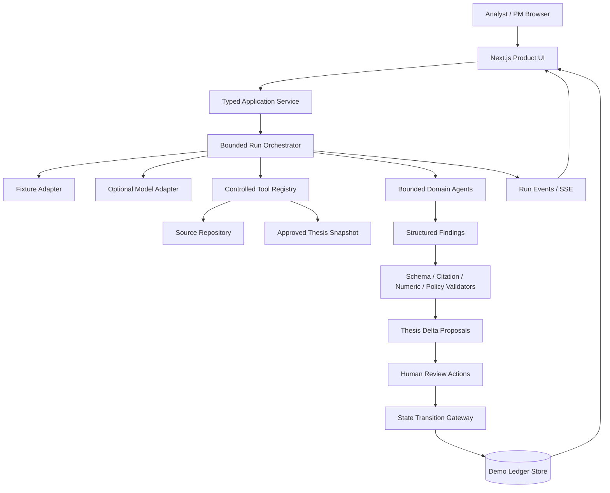
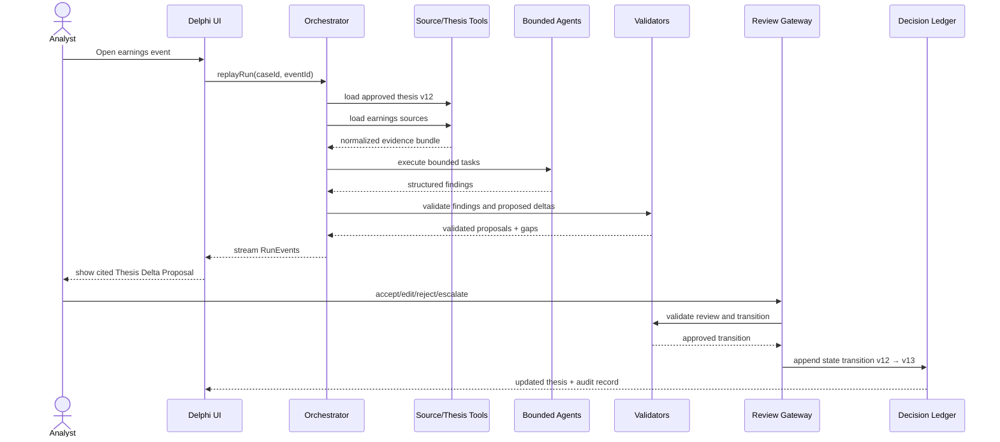
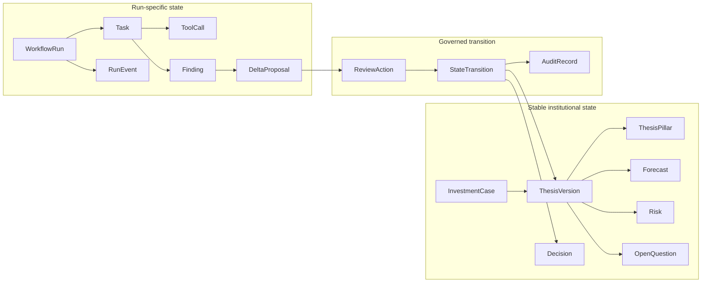
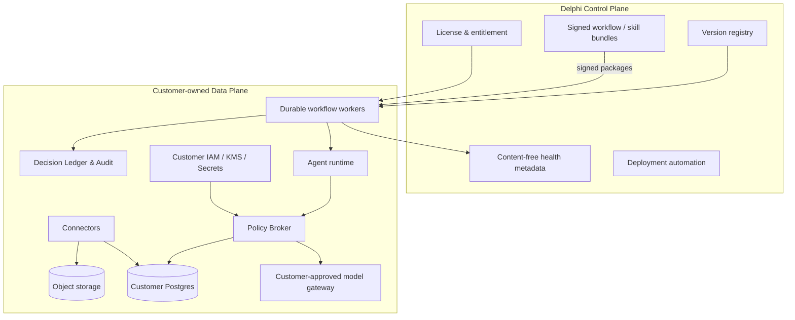
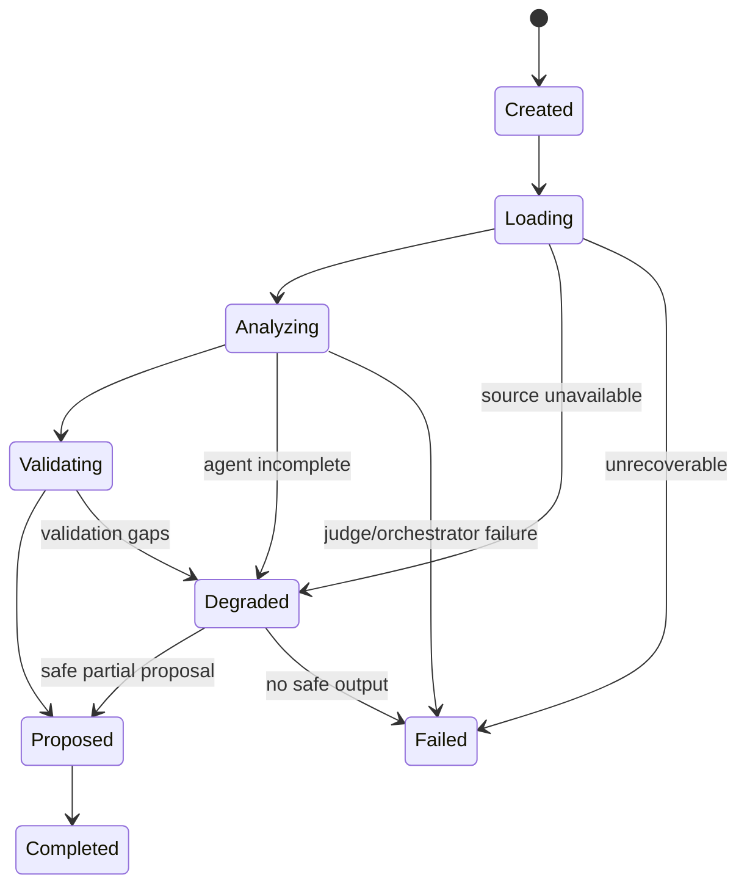

# Delphi System Architecture v0.2

**Audience:** engineering, technical evaluators, customers reviewing security  
**Principle:** prototype simplicity, production-compatible boundaries

---

## 1. Architecture thesis

Delphi is not designed as a free-form collection of agents. It is a governed state-transition system with bounded model participation.

```text
Models propose.
Validators constrain.
Humans approve.
The ledger records.
```

The most important separation is between:

1. **long-lived institutional state** — thesis, assumptions, forecasts, risks, approvals;
2. **run-specific execution state** — tasks, tools, findings, failures, proposals;
3. **human-reviewed state transitions** — the only path into approved state.

---

## 2. Prototype versus production

| Concern | Current prototype | Production direction |
|---|---|---|
| UI | Next.js web app | Same product surface |
| API | Next.js route handlers / typed service layer | Dedicated application service |
| Orchestration | In-process state machine | Durable workflow engine |
| Data | JSON fixtures + local persisted demo state | PostgreSQL canonical ledger |
| Context ingestion | typed manifest + 4 fixture-simulated read-only connectors | permission-aware customer connectors and durable ingestion jobs |
| Search | fixture lookup | permission-aware full-text/vector search |
| Graph | deterministic in-memory product projection; internal debug surface | Postgres relation projection; dedicated graph only if justified |
| Model | deterministic fixture adapter; optional live adapter | policy-routed customer-approved endpoints |
| Events | simulated / local SSE | durable event stream |
| Identity | demo roles | SSO / SCIM / RBAC / ABAC |
| Secrets | none in browser | customer KMS / secret manager |
| Deployment | static/full-stack demo | managed dedicated or customer-owned data plane |
| Audit | demo event log | append-only audit and retention controls |
| Security | synthetic data only | tenant isolation, policy broker, encryption, JIT support |

The prototype should preserve interfaces that can migrate, but it must not imitate production infrastructure unnecessarily.

### Implemented boundary status (2026-07-14)

- `createRuntimeComposition` is the single server-owned configuration seam. It selects deterministic fixture analysis by
  default and maps incomplete, unknown, or not-yet-implemented live configuration to a safe degraded descriptor.
- The UI receives only product-shaped capability fields. Provider credentials, raw environment values, SDK objects, and
  vendor errors are not serialized into the client, receipts, graph, or canonical state.
- Semantic equality, transition hashing, and ledger diffing share one governed thesis projection. A direct no-op or a
  multi-patch batch with no net effect is rejected before a version or transition can be recorded.
- `/debug/graph` displays the first graph projection: stable Delphi object IDs, typed edges, provenance references, and
  current/stale validation. It is read-only and in-memory; it is not Neo4j, does not execute Cypher, and owns no state.
- `/debug/context` displays the ingestion boundary that precedes analysis: five synthetic artifacts from four
  fixture-simulated read-only connectors, with owner, classification, source ACL, point-in-time, model policy,
  lifecycle, and derived-object links. It performs no upload, external transfer, persistence, RAG, or permission sync.
- Internal research/model artifacts block external-model access in the current fixture policy. Context metadata is
  projected with `context*` fields so an event-time v12 snapshot cannot overwrite a later canonical thesis version.

---

## 3. Prototype logical architecture



### Components

#### Product UI

- Change Inbox;
- Investment Case;
- Run Observatory;
- Delta Review;
- Decision Ledger;
- Privacy Receipt.

#### Typed Application Service

Keeps UI code from owning business logic. All mutations go through explicit service methods.

#### Run Orchestrator

Owns the run lifecycle:

```text
created → loading → analyzing → validating → proposed → completed
                                           ↘ degraded
                                           ↘ failed
```

#### Tool Registry

Exposes only named, schema-validated read tools to agents. No arbitrary shell, browser, file system, email, or trading tool.

#### Validators

Deterministic checks execute after model output:

- object schema;
- reference scope;
- source existence;
- citation coverage;
- number consistency;
- policy;
- duplicate transition;
- required reviewer.

#### State Transition Gateway

The only component allowed to change approved state. It requires a valid review action and records before/after versions.

---

## 4. Earnings-to-Thesis sequence



---

## 5. Stable state versus runtime state



Stable and runtime objects must never be represented by the same mutable record.

---

## 6. Decision graph

```mermaid
flowchart LR
    SD[Source Document] --> SE[Source Excerpt]
    SE --> C[Claim]
    C -->|supports / contradicts| A[Assumption]
    A --> TP[Thesis Pillar]
    TP --> DP[Delta Proposal]
    DP --> RA[Review Action]
    RA --> ST[State Transition]
    ST --> DEC[Decision]
    DEC --> POS[Position - read only]
    POS --> OUT[Outcome]
    OUT --> POST[Postmortem]
```



This graph is a projection over canonical relational records. A dedicated graph database should only be introduced when multi-hop queries, graph algorithms, or measured performance justify it.

The current debug projection covers the product objects already present in the runnable fixture: case, thesis and its
owned objects, sources and excerpts, workflow runs, proposals, reviews, and recorded transitions. Every relationship
endpoint must resolve to one of those stable product IDs, and a version/hash mismatch marks the projection stale instead
of changing canonical state.

The fund-context manifest adds connector nodes plus `PROVIDES_CONTEXT` and `CONTEXTUALIZES` edges. These edges are
derived from validated artifacts and inherit the same no-write rule as the rest of the projection. The artifact
manifest remains the event-time record; graph nodes remain a current read model, and neither can write approved state.

---

## 7. Production control plane and customer-owned data plane



### Control Plane may receive

- deployment and workflow version;
- license and entitlement;
- success / failure category;
- latency, cost, aggregate usage;
- non-content health metadata.

### Control Plane must not receive by default

- raw research documents;
- prompts and responses;
- embeddings;
- thesis or position content;
- decision graph content;
- internal meeting notes;
- restricted source excerpts.

---

## 8. Trust boundaries

```text
Browser
  ↓ authenticated application boundary
Application service
  ↓ typed command/query boundary
Orchestrator
  ↓ task-scoped capability boundary
Tool and model gateway
  ↓ customer policy / entitlement boundary
Sources, model endpoints, canonical state
```

Each crossing needs:

- authenticated actor;
- tenant and case context;
- purpose;
- data classification;
- allowed action;
- schema validation;
- audit event;
- timeout and idempotency where applicable.

Missing tenant or policy context must fail closed.

---

## 9. Run lifecycle and degradation



### Degraded semantics

A degraded run is a successful system outcome when it accurately represents missing information. It must retain:

- completed findings;
- missing sources;
- rejected patches;
- affected proposal sections;
- policy restrictions;
- retry eligibility.

A degraded run must not silently transform unrelated evidence into a complete-looking answer.

---

## 10. Event model

Minimum events:

```text
run_created
run_started
source_requested
source_loaded
source_unavailable
task_assigned
agent_started
finding_created
proposal_created
validation_passed
validation_failed
degraded_mode_entered
review_required
review_recorded
state_transition_applied
state_transition_rejected
report_ready
run_completed
run_failed
```

Every event includes:

```yaml
event_id:
run_id:
case_id:
tenant_id:
event_type:
occurred_at:
actor_type:
actor_id:
object_refs: []
status:
public_message:
metadata:
```

`public_message` is safe for product display. Raw internal errors remain separately protected.

---

## 11. Persistence strategy

### Prototype

- source fixtures: versioned JSON;
- demo state: localStorage or lightweight local database;
- state reset: one command;
- deterministic IDs;
- no real secrets.

### Production

PostgreSQL is the source of truth. Recommended patterns:

- versioned relation tables;
- append-only audit records;
- transactional state-transition gateway;
- outbox pattern for events;
- idempotency keys;
- row-level tenant protection;
- point-in-time fields;
- object storage for source artifacts;
- vector/search indexes as derived projections.

Avoid full event sourcing on day one. Preserve enough append-only transition history to replay approved state.

---

## 12. Bitemporal fields

For evidence and state, consider:

```text
occurred_at   — when the underlying event happened
published_at  — when a source was published
observed_at   — when Delphi obtained it
valid_from    — when a state became valid
valid_to      — when it ceased to be valid
recorded_at   — when Delphi recorded it
```

Also record:

- source version;
- model route and version;
- skill and workflow version;
- reviewer and approver;
- approval state;
- data policy version.

---

## 13. Model integration

All model providers implement one internal adapter:

```ts
interface ModelAdapter {
  execute<TInput, TOutput>(
    task: AgentTask<TInput>,
    context: ModelExecutionContext
  ): Promise<ModelExecutionResult<TOutput>>;
}
```

Requirements:

- structured output schema;
- timeout;
- retry policy;
- no provider-specific objects in domain code;
- model and prompt version capture;
- explicit refusal / parse / timeout states;
- fixture adapter implements the same interface.

The demo should boot and complete without a model API key.

---

## 14. Architecture decision records

### ADR-001 — Postgres before dedicated graph

**Decision:** canonical relational state first; graph as projection.  
**Reason:** transactional approval, versioning, audit, permissions, and reporting are primary risks.  
**Revisit when:** 3–6 hop impact queries or graph algorithms are frequent and measured.

### ADR-002 — Fixture-first public demo

**Decision:** deterministic fixture is default.  
**Reason:** EFL and customer demonstrations require reliability and truthful reproducibility.  
**Revisit when:** live provider success rate and latency are measured and acceptable.

### ADR-003 — Bounded agents

**Decision:** fixed task roles with typed outputs.  
**Reason:** explainability, validation, failure localization, and comparison across runs.  
**Revisit when:** customer evidence shows dynamic planning creates material incremental value.

### ADR-004 — Human approval before canonical mutation

**Decision:** all high-impact updates require authorized review.  
**Reason:** trust, accountability, compliance, and analyst adoption.  
**Revisit when:** a narrowly defined low-risk action passes historical and shadow evals.

### ADR-005 — No chain-of-thought auditing

**Decision:** store external process artifacts, not hidden reasoning.  
**Reason:** hidden reasoning is not a reliable institutional record; evidence, findings, tools, proposals, and decisions are.

---

## 15. Migration path

```text
Prototype:
Next.js + fixtures + local state + simulated SSE
    ↓
Pilot:
Next.js + Postgres + real source adapters + model gateway + background jobs
    ↓
Controlled production:
durable workflows + SSO/RBAC + audit + approved write-back
    ↓
Private deployment:
control plane + customer-owned data plane + signed bundles
    ↓
Platform:
multiple workflow packs + portfolio impact + eval-gated improvement
```

Every migration should preserve domain contracts and the review gateway.
