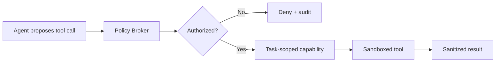

# Delphi Security, Privacy & Trust Architecture v0.2

**Audience:** customer CTO/CISO/CCO, investors, engineering  
**Status:** target architecture and prototype policy; not a claim of completed certification

---

## 1. Prototype policy

The public prototype uses **synthetic data only**.

It must not contain:

- real customer documents;
- live positions;
- API keys;
- licensed research;
- management-meeting notes;
- MNPI-like content;
- personally identifying customer records.

The prototype is evidence of product and architecture, not evidence of completed enterprise security certification.

The implemented runtime uses deterministic fixtures with external network access disabled. Its internal graph debug
surface is a read-only, in-memory projection of the same synthetic product objects; it has no database credentials,
provider secrets, canonical write authority, or graph persistence.

The implemented fund-context debug surface is also synthetic and local. Four connector records simulate read-only
boundaries but make no network connection and persist nothing. Each artifact carries owner, classification, access
policy, roles, as-of/observed timestamps, version/hash, model-routing policy, lifecycle state, deletion behavior, and
derived references. Internal model and memo artifacts require `externalModelAccess: blocked`; all current artifacts
require `externalTransfer: false`.

---

## 2. Threat model

Delphi must eventually protect:

- current positions, size, cost basis, and portfolio mappings;
- unpublished thesis and PM judgment;
- internal forecasts and valuation models;
- expert calls and management meetings;
- proprietary and alternative data;
- licensed sell-side research;
- restricted or MNPI-like material;
- internal dissent, rejected proposals, and decision history.

Primary risks:

1. cross-tenant leakage;
2. unauthorized access inside a customer organization;
3. model-provider retention or training;
4. standing Delphi employee access;
5. logs, embeddings, caches, or graph edges exposing sensitive views;
6. prompt injection causing data exfiltration;
7. long-lived credentials;
8. data-license violations;
9. software supply-chain compromise;
10. startup failure creating data lock-in;
11. automated state mutation without authority;
12. hindsight leakage in replay and evaluation.

---

## 3. Target deployment boundary

> **Delphi-managed Control Plane + Customer-owned Data Plane**

Customer environment owns:

- source documents and excerpts;
- financial models;
- approved thesis and positions;
- embeddings and indexes;
- Decision Ledger;
- agent runtime and workflow workers;
- IAM, KMS, secrets;
- customer-approved model endpoint;
- audit and retention configuration.

Delphi Control Plane handles:

- signed workflow / skill packages;
- version and entitlement;
- deployment health;
- aggregate non-content metrics;
- license and support workflow.

---

## 4. Why BYOK alone is insufficient

If traffic is:

```text
Customer → Delphi Cloud → Model API
```

Delphi Cloud can still see prompts and responses even when the customer owns the API key.

Institutional privacy requires control of:

- execution location;
- identity;
- secrets;
- network;
- logging;
- storage;
- model endpoint;
- support access.

The target is therefore BYO Data Plane, not only BYOK.

---

## 5. Data classification

```text
Public
Licensed
Internal
Restricted
MNPI-like
Synthetic
```

Each class can define:

- allowed model routes;
- external-network access;
- region;
- retention;
- caching;
- derivative-content policy;
- export policy;
- required human approval;
- support access.

Example:

| Class | External model | Web access | Retention | Canonical write |
|---|---|---|---|---|
| Public | policy-approved | optional | configured | human review |
| Licensed | contract-specific | usually restricted | contract-specific | human review |
| Internal | customer-owned endpoint preferred | off by default | customer policy | human review |
| Restricted | private/local route | off | minimal | elevated approval |
| MNPI-like | approved isolated route only | off | strict | compliance gate |
| Synthetic | fixture/local | off | demo | demo only |

---

## 6. Model policy

Every route should record:

- provider and model;
- endpoint owner;
- region;
- retention policy;
- training-use policy;
- data class allowed;
- fallback permission;
- output logging policy.

Unknown policy is not treated as zero retention.

Model substitution must not change source entitlement or approval requirements.

---

## 7. Agent and tool security



Requirements:

- no long-lived credentials in agents;
- read-only default;
- write / external action requires explicit policy and approval;
- tenant, case, user, purpose, and data class required;
- egress allowlist;
- strict input/output schema;
- idempotency for mutations;
- tool result treated as untrusted data;
- source ACL rechecked at retrieval;
- prompt injection cannot alter policy;
- missing context fails closed.

---

## 8. Human-in-the-loop governance

```text
Agent inferred
Analyst confirmed
PM approved
System recorded
```

Policies may vary by:

- object type;
- materiality;
- user ownership;
- data class;
- degraded state;
- workflow;
- customer firm overlay.

Examples:

- low-materiality open question: analyst may approve;
- high-materiality thesis pillar change: PM required;
- restricted-data result: compliance review;
- degraded evidence: auto-accept disabled;
- position or trade action: outside Delphi v0 scope.

---

## 9. Logging

Default metadata:

```text
run_id
tenant_id
user_id
workflow / skill version
model route
source IDs
policy decision
latency
token / cost aggregate
output hash
transition ID
status and error category
```

Not logged by default in Delphi Control Plane:

- raw prompt;
- raw response;
- retrieved excerpts;
- document body;
- thesis content;
- position content;
- tool secrets.

Debug access must be:

- customer approved;
- time-limited;
- encrypted;
- automatically expired;
- JIT;
- fully audited.

---

## 10. Embeddings and graph data

Embeddings are not anonymized data.

Requirements:

- tenant isolation;
- source-level ACL inheritance;
- encryption;
- deletion propagation;
- no cross-customer unified index;
- entitlement checked again during retrieval;
- model and index version recorded.

Graph relationships can expose strategy even when node text is hidden. Decision graph edges receive the same protection as thesis content.

---

## 11. Privacy Receipt

Every meaningful workflow should generate a visible receipt:

```text
Workflow: Earnings-to-Thesis v0.2.0
Data classification: Internal
Execution location: Customer AWS account
Model endpoint: Customer-owned endpoint
Retention: Zero
Raw content sent to Delphi Cloud: No
External web access: Disabled
Tools called: filings.read, transcript.read, thesis.read
Canonical writes: 3 proposed, 1 human-approved
Delphi support access: None
```

The receipt is a product feature, not just a compliance export.

---

## 12. Identity and authorization roadmap

### Prototype

- fixed demo roles;
- no real authentication;
- obvious synthetic-data marker.

### Pilot

- authenticated users;
- tenant and case ownership;
- role-based review;
- audit actor identity;
- least-privilege service accounts.

### Production

- SSO / SAML or OIDC;
- SCIM;
- RBAC + attribute/policy checks;
- group and pod separation;
- JIT administrative access;
- step-up approval for sensitive actions;
- session and device policies.

---

## 13. Encryption and key management

Target:

- TLS in transit;
- encryption at rest;
- customer KMS for private deployment;
- envelope encryption for sensitive objects;
- per-tenant separation;
- secrets in managed secret store;
- key rotation;
- backup encryption;
- export and deletion verification.

Do not claim customer-controlled keys until implemented and tested.

---

## 14. Retention, deletion, and exit

Customers need:

- configurable retention;
- legal hold support where applicable;
- source deletion propagation;
- embedding/index deletion;
- audit-preserving tombstones;
- full export in documented schemas;
- deletion certificate;
- termination runbook;
- source escrow / reproducible package strategy for private deployments.

Vendor trust includes the ability to leave.

---

## 15. Supply chain

Target controls:

- dependency lockfiles;
- software bill of materials;
- signed images and bundles;
- vulnerability scanning;
- protected release pipeline;
- reproducible builds;
- environment separation;
- patch policy;
- incident response;
- backup / recovery tests.

---

## 16. Trust Package checklist

Prepare externally:

- architecture and data-flow diagrams;
- data processing and model policy;
- subprocessor list;
- training / retention statements;
- tenant isolation;
- encryption and key management;
- access controls;
- employee access policy;
- logging and monitoring;
- incident response;
- business continuity;
- backup and recovery;
- vulnerability management;
- penetration-testing roadmap;
- model / skill / workflow version evidence;
- export, termination, and deletion;
- AI governance evidence template;
- sample Privacy Receipt.

---

## 17. Claims policy

### Safe now

- synthetic-data prototype;
- human-reviewed proposals;
- typed contracts;
- explicit runtime events;
- deterministic fixture replay;
- typed fail-closed runtime configuration and product-safe capability reporting;
- deterministic read-only graph projection over synthetic Delphi IDs;
- typed, validated synthetic context-ingestion manifest with read-only fixture connector records;
- target customer-owned data plane architecture;
- no automatic trading in v0.

### [DO NOT CLAIM YET]

- SOC 2 compliant;
- zero-retention across all providers;
- no hallucinations;
- production customer data never leaves environment;
- complete MNPI compliance;
- guaranteed audit compliance;
- fully air-gapped deployment;
- enterprise SLA;
- penetration tested;
- customer-controlled keys in live deployment.
- live customer repository connectivity, source-permission synchronization, or production deletion propagation.

Use “designed for,” “target architecture,” or “roadmap” until evidence exists.

---

## 18. Prototype security acceptance

- [ ] all visible data is synthetic;
- [ ] no secrets in repository or client bundle;
- [ ] no real external action;
- [ ] review roles enforced in demo logic;
- [ ] unauthorized transition test passes;
- [ ] prompt-injection fixture is blocked;
- [ ] privacy receipt matches actual demo behavior;
- [ ] reset removes demo mutations;
- [ ] error UI does not leak stack traces;
- [ ] marketing claims match implementation.
- [ ] `/debug/context` states that connectors are fixture simulations and no live customer system is connected;
- [ ] internal context blocks external-model access and every fixture artifact forbids external transfer;
- [ ] each derived context reference resolves to an existing stable Delphi object ID.
