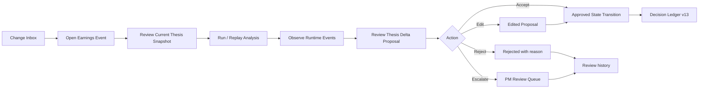
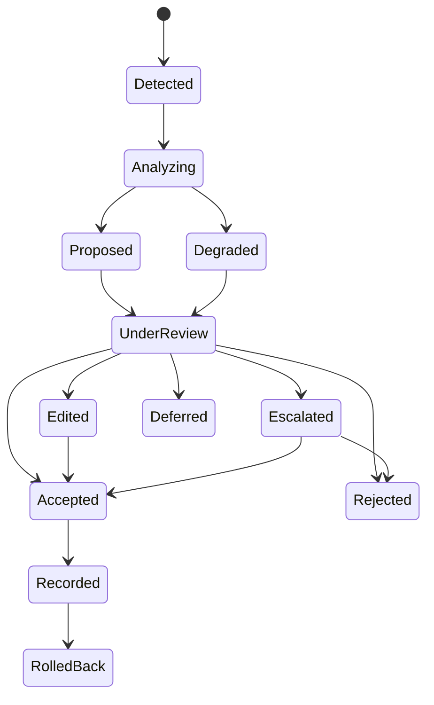
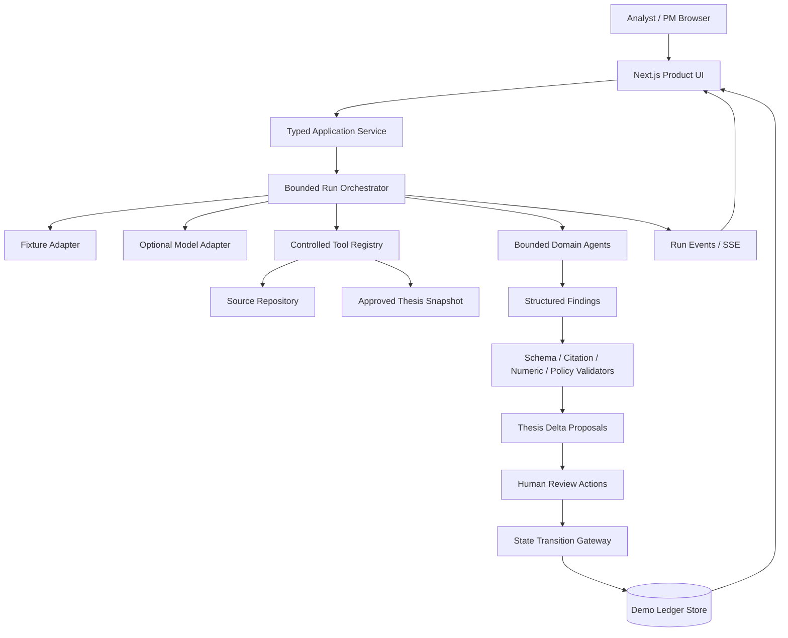
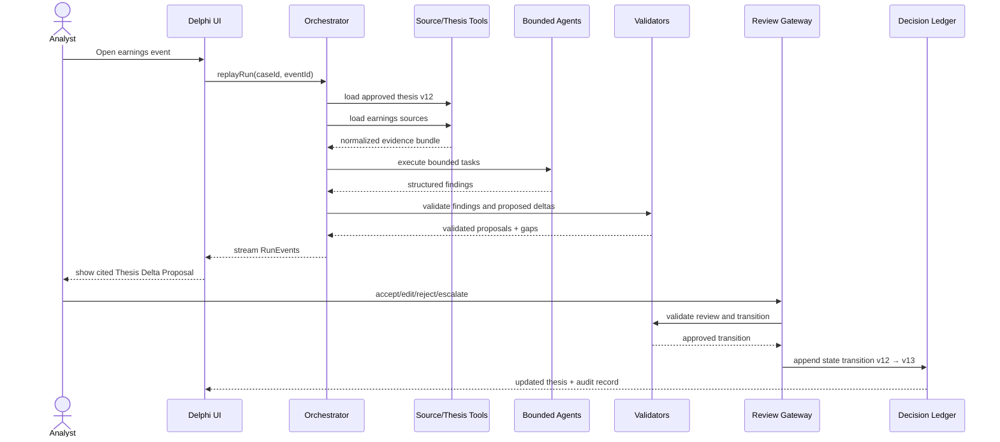
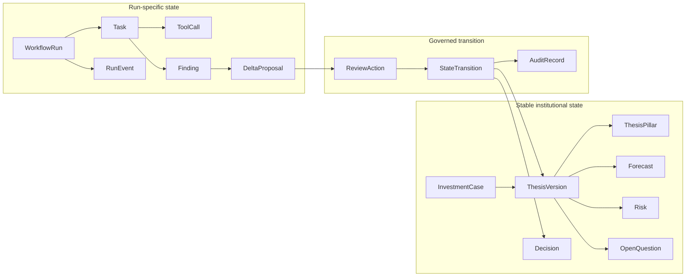
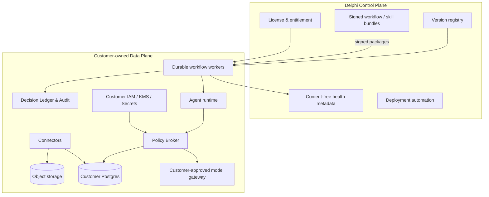
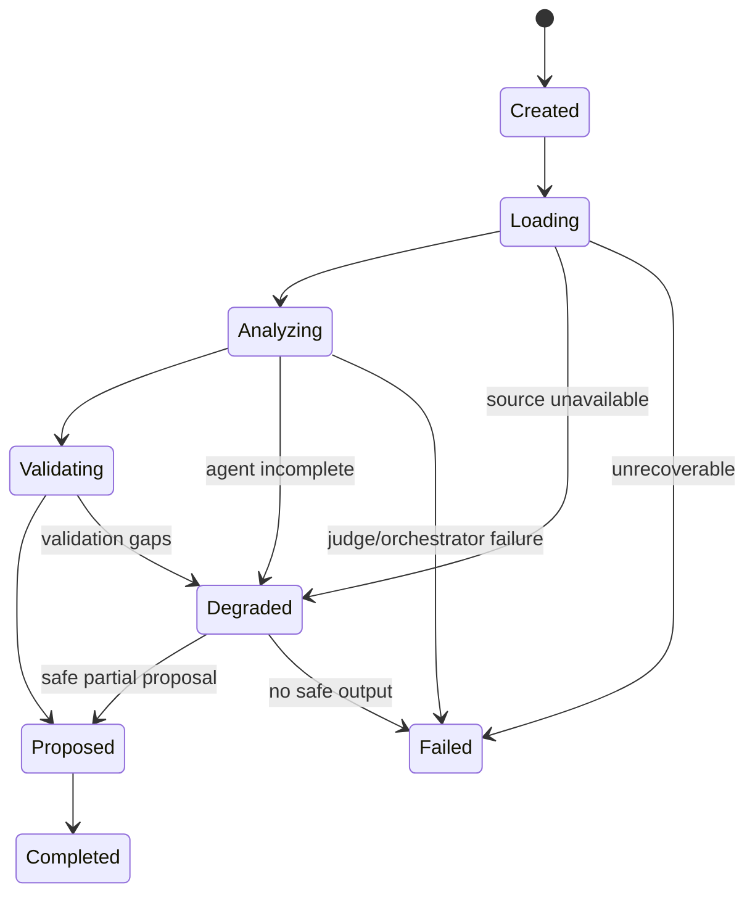
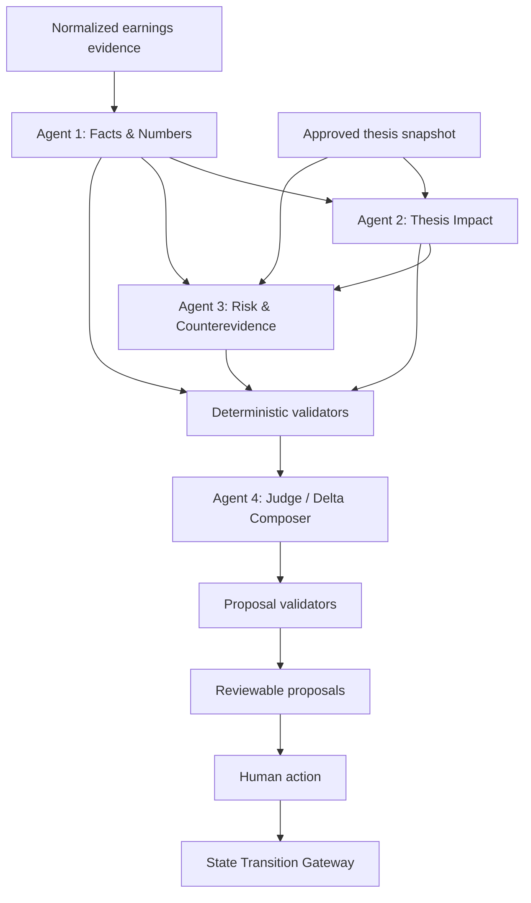
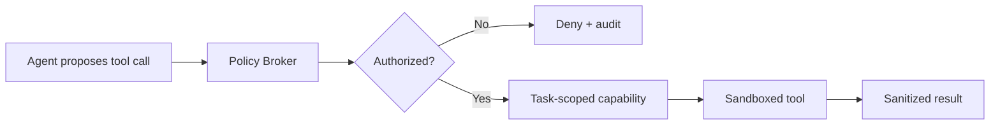

# Delphi Master Context for Claude Code / Codex

**Version:** 0.2  
**Date:** 2026-07-13  
**Primary task:** Build a deterministic, interactive Earnings-to-Thesis prototype that demonstrates evidence-backed state change, human approval, and a point-in-time Decision Ledger.

> Treat this file as the implementation source of truth. Where sections conflict, apply this precedence: Implementation Brief → PRD → Domain/API Contracts → Architecture → UX → Agent/Evals → Security → Demo Acceptance.

## Non-negotiable summary

1. The home surface is **Change Inbox**, not a blank chat.
2. The demo company and data are explicitly **synthetic**.
3. Fixture mode must complete the entire happy path without network access.
4. Model output is a **proposal**; canonical state changes only after authorized review.
5. Every proposal exposes evidence, uncertainty, confidence, materiality, and required reviewer.
6. A high-materiality PM-required proposal cannot be accepted by the Analyst role.
7. Approved changes create a reversible v12 → v13 Decision Ledger transition.
8. Degraded mode must continue safely and show blocked conclusions instead of inventing evidence.
9. The UI must show a Privacy Receipt and run provenance.
10. Do not implement trading, position changes, performance claims, or live customer data.

## Repository assets to load alongside this file

```text
fixtures/                         deterministic demo inputs and expected outputs
schemas/domain-types.ts          shared TypeScript contracts
schemas/domain.schema.json       JSON Schema for fixture validation
diagrams/ARCHITECTURE_DIAGRAMS.mmd
```

---


# Included document: Implementation Brief

**Source:** `12_BUILD_BRIEF_FOR_CLAUDE_CODE_CODEX.md`

# Delphi Prototype Build Brief for Claude Code / Codex

**Objective:** build a polished, deterministic, interactive web prototype of Delphi’s Earnings-to-Thesis workflow, plus a matching public company website.

This file is written to be pasted into a coding agent. The coding agent should also receive:

- `02_PROTOTYPE_PRD_ZH.md`
- `03_UX_AND_INTERACTION_SPEC_ZH.md`
- `04_SYSTEM_ARCHITECTURE.md`
- `05_DOMAIN_MODEL_AND_API_CONTRACTS.md`
- `06_AGENT_WORKFLOW_AND_EVALS.md`
- `07_SECURITY_PRIVACY_TRUST.md`
- `13_DEMO_SCRIPT_AND_ACCEPTANCE.md`

---

# 1. Master instruction

Build a production-quality **prototype**, not a fake screenshot and not a production financial platform.

The prototype must prove one coherent loop:

```text
Synthetic earnings event
→ compare against approved thesis v12
→ produce cited Thesis Delta Proposals
→ human Accept / Edit / Reject / Escalate / Defer
→ approved changes create thesis v13
→ Decision Ledger records before/after, evidence, actor, workflow, and versions
```

The app must work completely offline in deterministic fixture mode. A live LLM adapter may be added only behind the same typed interface and must not be required for the demo.

Do not build:

- automated trading;
- portfolio optimization;
- generic chat as the home page;
- arbitrary agent creation;
- real customer integrations;
- a graph database;
- enterprise auth;
- a complicated microservice architecture;
- unsupported security claims;
- a terminal animation with no domain meaning.

---

# 2. Preferred stack

Use a single TypeScript repository.

Recommended:

```text
Next.js App Router
TypeScript with strict mode
Tailwind CSS
shadcn/ui or accessible headless primitives
Zod for runtime validation
Zustand or a small typed store for demo state
Vitest for unit and contract tests
Playwright for key end-to-end flows
Lucide icons
```

Data:

```text
versioned JSON fixtures
+ local persisted demo state
+ service abstraction that can later use Postgres
```

Streaming:

```text
SSE-compatible event abstraction
```

For the prototype, simulated timed events are acceptable. Keep event objects real and typed.

Do not pin library versions in this document. Initialize with current stable releases and commit the lockfile.

---

# 3. Repository structure

```text
delphi/
├── apps/
│   ├── product/
│   │   ├── app/
│   │   ├── components/
│   │   ├── features/
│   │   ├── lib/
│   │   └── public/
│   └── website/
│       ├── app/
│       ├── components/
│       └── public/
├── packages/
│   ├── domain/
│   │   ├── types.ts
│   │   ├── schemas.ts
│   │   ├── transitions.ts
│   │   └── policies.ts
│   ├── fixtures/
│   │   ├── data/
│   │   └── loader.ts
│   ├── runtime/
│   │   ├── orchestrator.ts
│   │   ├── event-stream.ts
│   │   ├── model-adapter.ts
│   │   ├── fixture-adapter.ts
│   │   └── validators/
│   └── ui/
├── tests/
│   ├── contracts/
│   ├── unit/
│   └── e2e/
├── docs/
└── README.md
```

A simpler single-app structure is acceptable if the code remains modular. Do not create monorepo complexity unless it improves delivery.

---

# 4. Required routes

Product:

```text
/                         Change Inbox
/cases/arct-demo          Investment Case
/deltas/proposal-arct-001 Delta Review
/ledger                   Decision Ledger
/ledger/:transitionId     Ledger detail
/runs/run-arct-success    Run Observatory
/trust/run-arct-success   Privacy Receipt
```

Website:

```text
/
#product
#how-it-works
#security
#company
#contact
```

The product and website should share visual identity but clearly differ in purpose.

---

# 5. Required fixture

Use the synthetic company:

```yaml
company: Archetype Systems
ticker: ARCT-DEMO
sector: AI infrastructure software
case_id: case_arct_001
approved_thesis_version: 12
event: FY2026 Q2 Earnings
```

Create:

- approved thesis v12;
- three thesis pillars;
- five forecasts;
- three risks;
- three open questions;
- earnings release;
- transcript;
- team forecast;
- successful run;
- degraded run;
- four delta proposals;
- expected thesis v13;
- expected ledger transition;
- privacy receipt.

At least one proposal should:

- support an existing pillar;
- weaken a pillar;
- request forecast review;
- create a new open question.

The degraded case should remove or mark the transcript unavailable and block one high-impact proposal.

All fixture files must include:

```json
{
  "fixtureVersion": "0.2.0",
  "schemaVersion": "2026-07-13",
  "synthetic": true
}
```

---

# 6. Required application behavior

## Change Inbox

- cards or high-density rows;
- filters for Needs review, Escalated, Approved, Degraded;
- default item opens ARCT-DEMO review;
- materiality and evidence-health visible;
- synthetic demo badge;
- no chat-first interface.

## Investment Case

- approved thesis version and owner;
- thesis pillars;
- forecasts;
- risks;
- open questions;
- history timeline;
- clear labels for Approved team state versus Agent proposal.

## Run Observatory

- deterministic replay button;
- simulated runtime event stream;
- dual-pane layout;
- inspect structured finding;
- event durations;
- object refs;
- successful and degraded modes;
- no hidden chain-of-thought display.

## Delta Review

- structured delta cards;
- evidence drawer;
- action controls;
- Accept preview;
- Edit with original proposal retained;
- Reject reason;
- Escalate target;
- Defer date;
- only approved actions mutate formal state.

## Decision Ledger

- version transition v12 → v13;
- actor and reviewer;
- evidence refs;
- model / workflow / skill version;
- before / after diff;
- review history;
- rollback button can be a safe demo flow.

## Privacy Receipt

Must reflect actual prototype behavior:

```text
Synthetic data
Fixture adapter
No external web access
No raw content sent to Delphi Cloud
No support access
Canonical writes proposed / approved
```

## Reset

A visible reset command restores initial fixture hashes and state.

---

# 7. State rules

Implement the rules in domain code, not UI conditionals scattered across components.

1. `reject`, `escalate`, and `defer` never modify approved thesis.
2. `accept` can apply the validated patch if role and policy allow.
3. `edit` creates a human-authored patch, validates it, then applies.
4. high materiality requires PM in the demo.
5. degraded high-impact proposal cannot be accepted by analyst.
6. a transition must reference current `fromVersion`.
7. duplicate approval is idempotent.
8. successful transition increments version exactly once.
9. all review actions appear in history.
10. reset is deterministic.

---

# 8. Runtime and model adapter

Define:

```ts
export interface AnalysisAdapter {
  run(input: AnalysisInput): AsyncIterable<RunEvent>;
}
```

Implement:

```text
FixtureAnalysisAdapter — required
LiveModelAnalysisAdapter — optional
```

The fixture adapter should emit meaningful events with short delays so the process is observable. Tests should support zero-delay mode.

The optional live adapter:

- requires server-side environment variables;
- validates structured output;
- cannot write canonical state;
- has timeout and safe fallback;
- shows mode and model route in UI;
- is hidden when not configured.

---

# 9. Validators

Implement at least:

```text
validateSchema
validateReferenceScope
validateEvidenceRefs
validateCitationCoverage
validateNumbers
validateAllowedSemanticPatch
validateCurrentVersion
validateAuthorization
validateDegradedPolicy
validateIdempotency
```

Return typed `ValidationResult`.

The model or fixture should not be trusted merely because it matches TypeScript at compile time; fixture loading also passes Zod schemas.

---

# 10. Design requirements

Visual direction:

- dark institutional UI;
- high information density;
- restrained accent;
- crisp borders;
- monospace for IDs and versions;
- clear status labels;
- no excessive gradients;
- no stock images;
- no fake customer logos;
- no impossible numbers or “AI confidence 99%”.

Use responsive layout.

Accessibility:

- keyboard focus;
- semantic buttons;
- labels;
- reduced motion;
- contrast;
- status not expressed only by color.

All controls must work or be intentionally disabled with explanation.

---

# 11. Website requirements

Build the marketing site from `11_WEBSITE_COPY_EN.md`.

At minimum:

- hero;
- problem;
- Earnings-to-Thesis loop;
- product screenshots;
- human control;
- Decision Ledger;
- graceful degradation;
- security / data-plane direction;
- design-partner pilot;
- final CTA;
- FAQ;
- legal footer.

Use real screenshots or embedded product components where practical. Do not use unsupported certification badges or customer logos.

CTA can open a mailto or controlled contact form placeholder configured by environment variable.

---

# 12. Tests

## Unit / contract

- fixture schemas load;
- evidence refs resolve;
- proposal patches are allowed;
- unauthorized write fails;
- stale version fails;
- reject/escalate/defer do not mutate;
- accept mutates once;
- edit attributes human actor;
- degraded policy blocks unsafe approval;
- reset returns original hashes;
- privacy receipt matches mode.

## End-to-end

### E2E 1 — successful review

1. open inbox;
2. open ARCT-DEMO;
3. replay successful run;
4. open evidence;
5. accept a medium change;
6. edit another;
7. escalate high materiality;
8. open ledger;
9. verify v12 → v13 and only approved patches.

### E2E 2 — degraded run

1. simulate missing transcript;
2. run;
3. verify degraded banner;
4. verify blocked proposal;
5. escalate;
6. verify no canonical transition for blocked item.

### E2E 3 — reset

1. create a transition;
2. reset demo;
3. verify v12 and empty transition list.

---

# 13. Documentation

README must include:

- what Delphi is;
- what the prototype proves;
- how to install;
- how to run product and website;
- how to run tests;
- fixture versus live mode;
- architecture diagram;
- security disclaimer;
- demo script;
- known limitations.

Generate `.env.example` with no secrets.

---

# 14. Implementation phases

## Phase A — domain and fixture closure

- schemas;
- fixtures;
- transition rules;
- validators;
- tests.

Do not start with visual polish before the state loop works.

## Phase B — product shell

- navigation;
- inbox;
- case;
- run;
- review;
- ledger;
- trust.

## Phase C — interaction closure

- all actions;
- persistence;
- reset;
- degradation;
- evidence drawer.

## Phase D — website and polish

- website;
- screenshots;
- responsive;
- accessibility;
- animations;
- copy review.

## Phase E — presentation validation

- run 90-second and 4-minute scripts;
- fix dead ends;
- test clean browser;
- test offline;
- record demo.

---

# 15. Definition of done

The build is done when a new evaluator can:

- understand the product without verbal setup;
- replay a deterministic earnings analysis;
- inspect evidence and runtime artifacts;
- distinguish Agent proposal from Approved team state;
- complete a valid approval;
- see the exact Decision Ledger transition;
- understand a degraded result;
- reset the demo;
- visit a matching, credible company website;
- complete all of this without an external API key.

---

# 16. Pasteable coding-agent prompt

```text
You are implementing the Delphi Earnings-to-Thesis prototype.

Read all attached Delphi v0.2 documents before writing code. Treat the PRD, domain contracts, architecture, security rules, and acceptance criteria as requirements.

Build a polished TypeScript web application that demonstrates:
synthetic earnings event → validated thesis delta proposals → human review → approved thesis version update → Decision Ledger.

The default mode must be deterministic and work without network or model API keys. Implement real typed domain objects, fixture validation, review authorization, state-transition rules, runtime events, evidence links, degraded mode, persistence, and reset. Do not create a chat-first app, automated trading, arbitrary agents, or fake enterprise claims.

First inspect the existing repository. If an older Delphi thesis prototype exists, reuse only clean contracts or components that fit the new PRD. Do not preserve obsolete product scope merely to avoid refactoring.

Before coding, produce:
1. repository assessment;
2. proposed file plan;
3. identified conflicts with the specification;
4. implementation checklist.

Then implement in small, testable increments. After each phase, run typecheck, unit tests, and relevant E2E tests. Do not declare completion while controls are dead, the state transition is only visual, or the demo depends on an external provider.

The final deliverable must satisfy every item in 13_DEMO_SCRIPT_AND_ACCEPTANCE.md.
```


---


# Included document: Prototype PRD

**Source:** `02_PROTOTYPE_PRD_ZH.md`

# Delphi 交互原型 PRD v0.2

**产品：Delphi — Earnings-to-Thesis**  
**目标：构建一个可用于 EFL 申请、投资人沟通和设计伙伴访谈的稳定交互原型**  
**状态：Build-ready**

---

## 1. 原型命题

### 1.1 用户问题

财报之后，团队通常能得到很多摘要，却仍需要手工回答：

- 哪些事实偏离了我们的预测？
- 哪条已批准的 thesis pillar 被加强、削弱或推翻？
- 哪些数字存在口径问题？
- 哪些风险或 open questions 需要重新打开？
- 谁决定接受这次观点变化？
- 以后如何还原当时的证据与判断？

### 1.2 原型承诺

> **In minutes, Delphi turns an earnings event into a cited, reviewable thesis delta—and records only what the team approves.**

### 1.3 原型成功的可观察证据

评审者必须能独立完成：

1. 在 Change Inbox 看到一个新的 earnings event；
2. 打开事件并查看来源与当前批准的 thesis；
3. 启动或重放分析；
4. 观察受边界控制的 runtime 进度；
5. 阅读 3–5 个结构化 Thesis Deltas；
6. 打开每项 evidence；
7. 对一项 delta 执行 Accept / Edit / Reject / Escalate；
8. 看到正式 thesis version 从 `v12` 变成 `v13`；
9. 在 Decision Ledger 中查看 state transition、批准者、来源与版本；
10. 打开 Privacy Receipt；
11. 触发或查看一次 degraded run。

---

## 2. 用户与情境

### 2.1 主用户：Fundamental Equity Analyst

- 负责 10–25 个 names；
- 有 Excel 模型、thesis 文档和定期 review；
- 财报季需要快速比较预期、事实和管理层措辞；
- 不愿把最终判断交给模型；
- 不愿重复录入多个 tracker。

### 2.2 次用户：PM / CIO

- 只想看到 material changes；
- 需要快速知道“against our view”；
- 需要区分事实、模型推断与团队批准；
- 需要保留责任和历史。

### 2.3 辅助用户：Head of Research / COO / CCO

- 关注一致性、权限、审计和数据边界；
- 不一定参与每项 delta review。

---

## 3. Demo 数据策略

### 3.1 默认 fixture

使用明确标记为 **Synthetic Demo Data** 的虚构公司：

```yaml
company: Archetype Systems
ticker: ARCT-DEMO
sector: AI infrastructure software
event: FY2026 Q2 earnings
case_id: case_arct_001
approved_thesis_version: 12
```

避免真实公司数据随时间变化、许可争议或投资观点被误解。

### 3.2 可选真实案例

可保留 AAPL 或其他公开公司历史 fixture，用于技术连续性；任何外部演示都应显示：

> Historical public-data demonstration. Not investment advice.

### 3.3 两个必备案例

1. **Successful / mixed outcome**  
   有多个支持与反驳点，最终部分接受、部分升级；
2. **Degraded case**  
   transcript 缺失或数字冲突，系统明确标记无法完成的部分。

---

## 4. 核心用户旅程



---

## 5. 信息架构

### 一级导航

1. **Change Inbox**
2. **Cases**
3. **Decision Ledger**
4. **Runs**
5. **Trust**
6. Settings（低优先级）

### 页面

| Route | 页面 | 原型优先级 |
|---|---|---|
| `/` | Change Inbox | P0 |
| `/cases/arct-demo` | Investment Case | P0 |
| `/deltas/delta-001` | Delta Review | P0 |
| `/ledger` | Decision Ledger | P0 |
| `/runs/run-001` | Run Observatory | P0 |
| `/trust/run-001` | Privacy Receipt | P1 |
| `/settings` | Workflow / firm overlay mock | P2 |

---

## 6. P0 功能

### 6.1 Change Inbox

展示：

- company / event；
- event time；
- workflow；
- materiality score；
- review status；
- number of proposed changes；
- degraded / evidence conflict badge；
- required reviewer；
- SLA / elapsed time。

交互：

- filter by `Needs review / Escalated / Approved / Degraded`；
- filter by company；
- sort by materiality / recency；
- click opens Delta Review；
- keyboard navigation optional。

### 6.2 Investment Case

展示：

- approved thesis summary；
- thesis pillars；
- forecasts；
- catalysts；
- risks；
- open questions；
- owner / approver；
- current version；
- last reviewed timestamp；
- compact timeline of prior changes。

必须清楚区分：

```text
Approved team state
Private draft
Agent proposal
Historical version
```

### 6.3 Run / Replay

按钮：

- `Replay deterministic demo`
- `Run with model`（仅环境配置完成时显示）
- `Simulate degraded source`

Runtime events 逐步出现：

```text
run_created
sources_loaded
facts_reconciled
agent_started
finding_created
validation_passed / validation_failed
delta_proposed
review_required
report_ready
run_completed / run_degraded
```

用户可以查看：

- agent / system step；
- status；
- duration；
- input source IDs；
- output object IDs；
- degraded reason；
- cost / token mock（可选）；
- 不显示隐藏 chain of thought。

### 6.4 Delta Review

每项 delta card：

```yaml
delta_type: thesis_pillar_update | forecast_review | risk_update | open_question
headline:
what_changed:
against_our_view:
why_it_matters:
evidence_refs:
confidence:
materiality:
uncertainties:
recommended_follow_up:
required_reviewer:
proposed_patch:
```

动作：

- **Accept**
- **Edit**
- **Reject**
- **Escalate**
- **Defer**

规则：

- Accept 前弹出简短 change preview；
- Edit 后保留 Agent 原始 proposal 与用户修改；
- Reject 需要选择或填写 reason；
- Escalate 指定 PM queue；
- Defer 需要 review date；
- 所有动作写入 ReviewHistory；
- 只有 Accept 或经批准的 Edit 会产生正式 StateTransition。

### 6.5 Decision Ledger

列表展示：

- transition ID；
- case / company；
- from version → to version；
- change type；
- actor；
- reviewer / approver；
- timestamp；
- evidence count；
- workflow / model / skill version；
- rollback eligibility。

详情页展示：

- before / after diff；
- proposal；
- edit history；
- evidence lineage；
- approval；
- run；
- privacy receipt；
- outcome placeholder。

### 6.6 Degraded mode

必须有真实 UI，不只是 toast：

- 页面顶部状态条；
- 明确 reasons；
- 未完成 section 保持 empty / unavailable；
- 不允许低质量推断自动补全；
- 每项受影响 delta 显示 `Evidence insufficient`；
- Accept 可被 policy 禁用，或需要 escalation；
- Ledger 记录“未发生状态变更”。

---

## 7. P1 功能

- Evidence drawer：来源、片段、发布/观察时间、分类；
- Privacy Receipt；
- before / after split diff；
- portfolio impact mock；
- PM brief preview；
- export JSON；
- copy share link；
- replay speed control；
- command palette；
- responsive tablet layout。

---

## 8. 非功能要求

### 稳定性

- 默认 Demo 不依赖外网；
- 页面刷新后 fixture state 可恢复；
- 有 `Reset demo`；
- 关键交互不出现死按钮；
- fixture replay 在相同版本下结果一致。

### 性能

- 首屏应快速加载；
- replay 总时长通过模拟控制在演示友好范围；
- 交互响应无明显延迟；
- 大组件按需加载。

### 可解释性

- 每个结论至少有一个 evidence link 或显示无证据；
- Fact / Inference / Team Judgment / Unknown 使用明确标签；
- Confidence 不用伪精确小数，可用 Low / Medium / High 与解释；
- materiality 与 confidence 分开。

### 安全

- 仅 synthetic fixture；
- 不储存真实 API key；
- 浏览器 bundle 不含 secret；
- 所有写操作仅作用于 demo store；
- 对外页面显示“Not investment advice”。

### 可访问性

- 键盘可操作；
- 焦点状态明确；
- 状态不只依赖颜色；
- 对比度满足常规可访问要求；
- motion 支持 reduced-motion。

---

## 9. 领域状态机



---

## 10. 验收标准

### Scenario A — happy path

- [ ] 进入 Change Inbox 能看到 ARCT-DEMO；
- [ ] 打开 delta 后能看到 v12 approved thesis；
- [ ] replay 产生可观察 runtime events；
- [ ] 至少三项 delta 有 evidence；
- [ ] 接受一项、编辑一项、升级一项；
- [ ] v12 → v13 只包含已批准变化；
- [ ] rejected / escalated 项不进入正式状态；
- [ ] Ledger 可查看 before / after 和审批；
- [ ] 刷新后 state 仍在；
- [ ] Reset 恢复初始状态。

### Scenario B — degraded path

- [ ] transcript source 被模拟为 unavailable；
- [ ] run 状态为 degraded；
- [ ] UI 指出受影响分析；
- [ ] 无证据 section 不被模型填满；
- [ ] 高影响 Accept 被禁用或要求 escalation；
- [ ] Ledger 记录 review，但不产生错误的正式 transition。

### Scenario C — presentation

- [ ] 90 秒内能讲清产品；
- [ ] 4 分钟内能完成一项审批；
- [ ] 每个页面都适合截图；
- [ ] 网站文案、Demo 文案和申请定位一致；
- [ ] 无需解释底层代码即可理解差异。

---

## 11. 产品分析事件

原型可用简单本地 telemetry：

```text
demo_opened
inbox_item_opened
run_started
run_replayed
evidence_opened
delta_accepted
delta_edited
delta_rejected
delta_escalated
ledger_opened
privacy_receipt_opened
degraded_case_started
demo_reset
```

不得收集敏感内容；仅用于观察评审和访谈中的交互摩擦。

---

## 12. 交付物

最低交付：

```text
working web app
+ deterministic fixtures
+ interactive approval flow
+ ledger
+ run observability
+ degraded demo
+ responsive marketing website
+ README and architecture
+ 90-second demo recording
```

高质量加分：

```text
optional live-model adapter
+ source excerpt viewer
+ privacy receipt
+ exported audit JSON
+ test suite
+ public demo URL with reset
```


---


# Included document: UX & Interaction Specification

**Source:** `03_UX_AND_INTERACTION_SPEC_ZH.md`

# Delphi UX 与交互规格 v0.2

**设计方向：Institutional, calm, information-dense, inspectable**  
**默认主题：深色；支持浅色不是原型阻塞项**  
**核心界面：Change Inbox + Delta Review + Decision Ledger**

---

## 1. 体验目标

用户第一次打开 Delphi，应在 10 秒内理解：

1. 这不是聊天机器人；
2. 系统正在处理真实 workflow 中的“变化”；
3. 每项变化与已批准 thesis 发生比较；
4. 用户保留最终判断权；
5. 所有批准后的变化可追踪。

体验应像：

> terminal-like information density × modern enterprise SaaS clarity × investment committee discipline

而不是：

- 消费级 AI 渐变首页；
- 无限空白 chat；
- 炫技式 node graph；
- 模糊的“AI confidence 97.3%”；
- 复杂到无法演示的 Bloomberg 仿制品。

---

## 2. 全局布局

```text
┌──────────────────────────────────────────────────────────────────┐
│ Delphi / Workspace      Search       Demo data   User / Status  │
├───────────────┬──────────────────────────────────────────────────┤
│ Change Inbox  │                                                  │
│ Cases         │                 Main content                     │
│ Ledger        │                                                  │
│ Runs          │                                                  │
│ Trust         │                                                  │
│               │                                                  │
│ ───────────   │                                                  │
│ Demo controls │                                                  │
└───────────────┴──────────────────────────────────────────────────┘
```

### Sidebar

- 固定宽度，图标 + 文本；
- 当前 route 高亮；
- 显示 `Synthetic demo` badge；
- 底部有 `Reset demo`；
- 不显示无功能的十几个菜单。

### Top bar

- workspace / fund 名；
- global search mock；
- data mode；
- run health；
- user avatar / reviewer role。

---

## 3. 视觉语言

### 色彩语义

| 语义 | 建议 |
|---|---|
| Background | near-black / blue-black |
| Panel | slightly elevated neutral |
| Primary accent | cool cyan / indigo，低饱和 |
| Positive / supported | green，但避免“买入”含义 |
| Negative / contradicted | red / rose |
| Warning / uncertain | amber |
| Informational | blue |
| Approved state | distinct solid badge |
| Agent proposal | outlined / dashed treatment |

状态必须同时有文字或图标，不能只靠颜色。

### Typography

- UI：系统 sans，保证跨平台；
- 数字、版本、ID、事件：monospace；
- 标题克制，不使用超大营销字号；
- 正文 line-height 适合高密度阅读；
- 重要差异用结构和留白，不用彩虹渐变。

### 卡片

- 边框比阴影重要；
- 小圆角；
- hover 只轻微改变边框和背景；
- 支持 split-view；
- source / evidence 使用可折叠 drawer。

---

## 4. Change Inbox

### 信息层级

```text
[Needs review] [High materiality]     14m ago
Archetype Systems — FY26 Q2 Earnings
3 thesis deltas · 1 forecast review · 1 unresolved conflict
Required reviewer: Analyst
```

每项 row / card 需要：

- status；
- company / event；
- workflow；
- materiality；
- proposed changes；
- evidence health；
- reviewer；
- time；
- `Open review` 主动作。

### 筛选

- Needs review；
- Escalated；
- Approved；
- Degraded；
- Company；
- Materiality；
- Date。

默认只显示需要用户动作的内容，避免首页成为信息坟场。

### 空状态

> No material changes need your review.  
> Delphi is monitoring 18 active cases.

避免“Start chatting”。

---

## 5. Investment Case

### Header

- company；
- owner；
- approved version；
- last review；
- status；
- `Compare versions`；
- `Open latest event`。

### Tabs

1. Overview
2. Thesis
3. Forecasts
4. Risks
5. Evidence
6. History

### Thesis pillar card

```text
Pillar 01 · Approved
Enterprise AI infrastructure demand remains durable
Owner: A. Chen · Last approved: Jun 14
Evidence health: 8 supporting / 2 contradicting
```

每个 pillar 有：

- approved statement；
- confidence as team judgment；
- supporting / contradicting evidence；
- latest delta；
- owner；
- version；
- open questions。

不要混合“Agent confidence”与“team conviction”。

---

## 6. Run Observatory

建议使用双栏：

```text
┌──────────────────────────────┬───────────────────────────────┐
│ Runtime timeline             │ Findings / object inspector   │
│ ✓ Sources loaded             │ selected event                │
│ ✓ Facts reconciled           │ source refs                   │
│ ● Thesis impact              │ structured output             │
│ ○ Risk analysis              │ validation state              │
│ ○ Judge                      │ object IDs                     │
└──────────────────────────────┴───────────────────────────────┘
```

### Timeline row

- step name；
- system / agent；
- status；
- duration；
- objects produced；
- expandable metadata。

### 不展示

- hidden chain of thought；
- raw prompt 默认全文；
- fake terminal gibberish；
- 每个 token streaming；
- 对客户没有意义的内部 stack trace。

### 展示

- task；
- tool / source；
- structured finding；
- validator result；
- degraded reason；
- version；
- elapsed time。

---

## 7. Delta Review

### 页面顶部

- event summary；
- current approved version；
- proposed version；
- run state；
- evidence health；
- outstanding conflicts；
- required reviewer。

### Delta card anatomy

```text
[Thesis pillar] [Weakens] [High materiality]

Demand durability is less certain in the mid-market segment

WHAT CHANGED
Net retention fell below the team’s expected range...

AGAINST OUR VIEW
The approved thesis assumes...

WHY IT MATTERS
This reduces confidence in...

EVIDENCE
[Q2 shareholder letter §3] [Call transcript 12:41]

UNKNOWN
Whether weakness reflects temporary implementation delays...

RECOMMENDED
Revisit FY27 net retention assumption.

[Accept] [Edit] [Reject] [Escalate] [Defer]
```

### Action behavior

#### Accept

Modal:

```text
This will:
• update Thesis Pillar 02
• create version v13
• record you as reviewer
• retain the original proposal and evidence
```

主按钮：`Approve and record`

#### Edit

- inline structured editor；
- agent original visible in collapsible area；
- difference preview；
- edit reason optional but encouraged；
- approved record attributes judgment to user。

#### Reject

Reason chips：

- not material；
- incorrect evidence；
- duplicate；
- wrong interpretation；
- already reflected；
- insufficient evidence；
- other。

#### Escalate

- select PM；
- add note；
- preserve due date；
- does not update formal state。

#### Defer

- choose date / event trigger；
- remains in queue；
- no state mutation。

---

## 8. Evidence Drawer

展示：

- source title；
- document type；
- published_at；
- observed_at；
- data classification；
- exact excerpt；
- page / section / timestamp；
- source version / hash；
- supports / contradicts relation；
- numeric extraction；
- license / access indicator mock。

用户应能从 delta 一键打开精确证据，而不是只看到来源首页。

---

## 9. Decision Ledger

### 列表

高密度表格适合：

```text
Time | Case | Transition | Actor | Evidence | Workflow | Status
```

### 详情

四个区块：

1. **State diff**
2. **Evidence lineage**
3. **Approval & responsibility**
4. **Execution & privacy metadata**

### Diff 表达

```diff
- Mid-market demand remains resilient
+ Mid-market demand remains resilient, but implementation delays
+ create a material downside risk for FY27 net retention
```

同时显示结构化字段，不只显示文字 diff。

---

## 10. Trust / Privacy Receipt

对每次 run 显示：

```text
Workflow: Earnings-to-Thesis v0.2.0
Data classification: Synthetic demo
Execution location: Local demo runtime
Model endpoint: Fixture adapter
Raw content sent to Delphi Cloud: No
External web access: Disabled
Tools called: fixture.read, thesis.read, validator.run
Canonical writes: 2 proposed, 1 human-approved
Support access: None
```

该页面既服务客户，也向 EFL 证明安全是架构属性而非脚注。

---

## 11. Degraded 与错误状态

### Degraded banner

> Analysis completed with gaps. The earnings call transcript was unavailable, so management-guidance interpretation is not proposed for approval.

### 禁止的错误处理

- 静默隐藏；
- 自动用新闻替代 transcript 而不说明；
- 把未验证 section 填满；
- 只显示 “Something went wrong”；
- run 失败后丢失已完成发现。

### 恰当行为

- 保留部分结果；
- 标记受影响对象；
- 禁止不安全 approval；
- 给出 retry / escalate / inspect source；
- 记录完整 degraded reason。

---

## 12. 响应式

### Desktop

- full sidebar；
- split view；
- evidence drawer；
- table。

### Tablet

- compact sidebar；
- delta 与 evidence 可切换；
- 保留审批动作。

### Mobile

营销网站需要完整适配；产品原型只需能查看，不要求移动端完成复杂 review。

---

## 13. 动效

- runtime event 逐项出现；
- status transition 使用 150–250ms；
- Ledger 更新后短暂强调新行；
- drawer 与 modal 平滑但克制；
- 支持 `prefers-reduced-motion`；
- 不用持续闪烁的 Agent “思考”动画。

---

## 14. 页面文案语气

使用：

- precise；
- calm；
- accountable；
- evidence-first；
- boundary-aware。

避免：

- magical；
- autonomous；
- revolutionary；
- guaranteed；
- superhuman；
- replacement；
- “AI has decided”。

推荐：

- `Delphi proposes`
- `Evidence supports`
- `Evidence is insufficient`
- `Analyst approved`
- `Recorded in the Decision Ledger`
- `Requires PM review`

---

## 15. 网站截图计划

原型完成后，网站至少使用以下真实产品截图：

1. Change Inbox；
2. Delta Review；
3. Evidence Drawer；
4. Decision Ledger state diff；
5. Run Observatory；
6. Privacy Receipt。

不要用抽象 3D 球体代替产品证据。


---


# Included document: System Architecture

**Source:** `04_SYSTEM_ARCHITECTURE.md`

# Delphi System Architecture v0.2

**Audience:** engineering, technical evaluators, customers reviewing security  
**Principle:** prototype simplicity, production-compatible boundaries

---

## 1. Architecture thesis

Delphi is not designed as a free-form collection of agents. It is a governed state-transition system with bounded model participation.

```text
Models propose.
Validators constrain.
Humans approve.
The ledger records.
```

The most important separation is between:

1. **long-lived institutional state** — thesis, assumptions, forecasts, risks, approvals;
2. **run-specific execution state** — tasks, tools, findings, failures, proposals;
3. **human-reviewed state transitions** — the only path into approved state.

---

## 2. Prototype versus production

| Concern | EFL prototype | Production direction |
|---|---|---|
| UI | Next.js web app | Same product surface |
| API | Next.js route handlers / typed service layer | Dedicated application service |
| Orchestration | In-process state machine | Durable workflow engine |
| Data | JSON fixtures + local persisted demo state | PostgreSQL canonical ledger |
| Search | fixture lookup | permission-aware full-text/vector search |
| Graph | computed projection in UI | Postgres relation projection; dedicated graph only if justified |
| Model | deterministic fixture adapter; optional live adapter | policy-routed customer-approved endpoints |
| Events | simulated / local SSE | durable event stream |
| Identity | demo roles | SSO / SCIM / RBAC / ABAC |
| Secrets | none in browser | customer KMS / secret manager |
| Deployment | static/full-stack demo | managed dedicated or customer-owned data plane |
| Audit | demo event log | append-only audit and retention controls |
| Security | synthetic data only | tenant isolation, policy broker, encryption, JIT support |

The prototype should preserve interfaces that can migrate, but it must not imitate production infrastructure unnecessarily.

---

## 3. Prototype logical architecture



### Components

#### Product UI

- Change Inbox;
- Investment Case;
- Run Observatory;
- Delta Review;
- Decision Ledger;
- Privacy Receipt.

#### Typed Application Service

Keeps UI code from owning business logic. All mutations go through explicit service methods.

#### Run Orchestrator

Owns the run lifecycle:

```text
created → loading → analyzing → validating → proposed → completed
                                           ↘ degraded
                                           ↘ failed
```

#### Tool Registry

Exposes only named, schema-validated read tools to agents. No arbitrary shell, browser, file system, email, or trading tool.

#### Validators

Deterministic checks execute after model output:

- object schema;
- reference scope;
- source existence;
- citation coverage;
- number consistency;
- policy;
- duplicate transition;
- required reviewer.

#### State Transition Gateway

The only component allowed to change approved state. It requires a valid review action and records before/after versions.

---

## 4. Earnings-to-Thesis sequence



---

## 5. Stable state versus runtime state



Stable and runtime objects must never be represented by the same mutable record.

---

## 6. Decision graph

```mermaid
flowchart LR
    SD[Source Document] --> SE[Source Excerpt]
    SE --> C[Claim]
    C -->|supports / contradicts| A[Assumption]
    A --> TP[Thesis Pillar]
    TP --> DP[Delta Proposal]
    DP --> RA[Review Action]
    RA --> ST[State Transition]
    ST --> DEC[Decision]
    DEC --> POS[Position - read only]
    POS --> OUT[Outcome]
    OUT --> POST[Postmortem]
```



This graph is a projection over canonical relational records. A dedicated graph database should only be introduced when multi-hop queries, graph algorithms, or measured performance justify it.

---

## 7. Production control plane and customer-owned data plane



### Control Plane may receive

- deployment and workflow version;
- license and entitlement;
- success / failure category;
- latency, cost, aggregate usage;
- non-content health metadata.

### Control Plane must not receive by default

- raw research documents;
- prompts and responses;
- embeddings;
- thesis or position content;
- decision graph content;
- internal meeting notes;
- restricted source excerpts.

---

## 8. Trust boundaries

```text
Browser
  ↓ authenticated application boundary
Application service
  ↓ typed command/query boundary
Orchestrator
  ↓ task-scoped capability boundary
Tool and model gateway
  ↓ customer policy / entitlement boundary
Sources, model endpoints, canonical state
```

Each crossing needs:

- authenticated actor;
- tenant and case context;
- purpose;
- data classification;
- allowed action;
- schema validation;
- audit event;
- timeout and idempotency where applicable.

Missing tenant or policy context must fail closed.

---

## 9. Run lifecycle and degradation



### Degraded semantics

A degraded run is a successful system outcome when it accurately represents missing information. It must retain:

- completed findings;
- missing sources;
- rejected patches;
- affected proposal sections;
- policy restrictions;
- retry eligibility.

A degraded run must not silently transform unrelated evidence into a complete-looking answer.

---

## 10. Event model

Minimum events:

```text
run_created
run_started
source_requested
source_loaded
source_unavailable
task_assigned
agent_started
finding_created
proposal_created
validation_passed
validation_failed
degraded_mode_entered
review_required
review_recorded
state_transition_applied
state_transition_rejected
report_ready
run_completed
run_failed
```

Every event includes:

```yaml
event_id:
run_id:
case_id:
tenant_id:
event_type:
occurred_at:
actor_type:
actor_id:
object_refs: []
status:
public_message:
metadata:
```

`public_message` is safe for product display. Raw internal errors remain separately protected.

---

## 11. Persistence strategy

### Prototype

- source fixtures: versioned JSON;
- demo state: localStorage or lightweight local database;
- state reset: one command;
- deterministic IDs;
- no real secrets.

### Production

PostgreSQL is the source of truth. Recommended patterns:

- versioned relation tables;
- append-only audit records;
- transactional state-transition gateway;
- outbox pattern for events;
- idempotency keys;
- row-level tenant protection;
- point-in-time fields;
- object storage for source artifacts;
- vector/search indexes as derived projections.

Avoid full event sourcing on day one. Preserve enough append-only transition history to replay approved state.

---

## 12. Bitemporal fields

For evidence and state, consider:

```text
occurred_at   — when the underlying event happened
published_at  — when a source was published
observed_at   — when Delphi obtained it
valid_from    — when a state became valid
valid_to      — when it ceased to be valid
recorded_at   — when Delphi recorded it
```

Also record:

- source version;
- model route and version;
- skill and workflow version;
- reviewer and approver;
- approval state;
- data policy version.

---

## 13. Model integration

All model providers implement one internal adapter:

```ts
interface ModelAdapter {
  execute<TInput, TOutput>(
    task: AgentTask<TInput>,
    context: ModelExecutionContext
  ): Promise<ModelExecutionResult<TOutput>>;
}
```

Requirements:

- structured output schema;
- timeout;
- retry policy;
- no provider-specific objects in domain code;
- model and prompt version capture;
- explicit refusal / parse / timeout states;
- fixture adapter implements the same interface.

The demo should boot and complete without a model API key.

---

## 14. Architecture decision records

### ADR-001 — Postgres before dedicated graph

**Decision:** canonical relational state first; graph as projection.  
**Reason:** transactional approval, versioning, audit, permissions, and reporting are primary risks.  
**Revisit when:** 3–6 hop impact queries or graph algorithms are frequent and measured.

### ADR-002 — Fixture-first public demo

**Decision:** deterministic fixture is default.  
**Reason:** EFL and customer demonstrations require reliability and truthful reproducibility.  
**Revisit when:** live provider success rate and latency are measured and acceptable.

### ADR-003 — Bounded agents

**Decision:** fixed task roles with typed outputs.  
**Reason:** explainability, validation, failure localization, and comparison across runs.  
**Revisit when:** customer evidence shows dynamic planning creates material incremental value.

### ADR-004 — Human approval before canonical mutation

**Decision:** all high-impact updates require authorized review.  
**Reason:** trust, accountability, compliance, and analyst adoption.  
**Revisit when:** a narrowly defined low-risk action passes historical and shadow evals.

### ADR-005 — No chain-of-thought auditing

**Decision:** store external process artifacts, not hidden reasoning.  
**Reason:** hidden reasoning is not a reliable institutional record; evidence, findings, tools, proposals, and decisions are.

---

## 15. Migration path

```text
Prototype:
Next.js + fixtures + local state + simulated SSE
    ↓
Pilot:
Next.js + Postgres + real source adapters + model gateway + background jobs
    ↓
Controlled production:
durable workflows + SSO/RBAC + audit + approved write-back
    ↓
Private deployment:
control plane + customer-owned data plane + signed bundles
    ↓
Platform:
multiple workflow packs + portfolio impact + eval-gated improvement
```

Every migration should preserve domain contracts and the review gateway.


---


# Included document: Domain Model & API Contracts

**Source:** `05_DOMAIN_MODEL_AND_API_CONTRACTS.md`

# Delphi Domain Model & API Contracts v0.2

**Language:** TypeScript-first contracts  
**Purpose:** keep UI, orchestration, validation, fixtures, and persistence aligned

---

## 1. Contract principles

1. Domain objects have stable identity.
2. Runtime objects are separate from approved state.
3. Model output is untrusted until validated.
4. Proposal does not equal decision.
5. A review action does not equal a state transition unless authorized.
6. Every approved transition references a before version, after version, run, evidence, and human actor.
7. Missing or contradictory evidence is represented explicitly.
8. Interfaces are versioned.

---

## 2. Shared primitives

```ts
export type ISODateTime = string;
export type UUID = string;
export type EntityId = string;
export type TenantId = string;
export type CaseId = string;
export type RunId = string;
export type SourceId = string;

export type Confidence = "low" | "medium" | "high";
export type Materiality = "low" | "medium" | "high" | "critical";
export type DataClassification =
  | "public"
  | "licensed"
  | "internal"
  | "restricted"
  | "mnpi_like"
  | "synthetic";

export type EvidenceStance =
  | "supports"
  | "contradicts"
  | "contextualizes"
  | "unknown";

export interface VersionRef {
  version: number;
  recordedAt: ISODateTime;
}
```

---

## 3. Sources and evidence

```ts
export interface SourceDocument {
  sourceId: SourceId;
  tenantId: TenantId;
  title: string;
  sourceType:
    | "earnings_release"
    | "filing"
    | "transcript"
    | "presentation"
    | "news"
    | "internal_note"
    | "financial_model"
    | "other";
  issuerEntityId?: EntityId;
  uri?: string;
  publishedAt?: ISODateTime;
  observedAt: ISODateTime;
  classification: DataClassification;
  contentHash: string;
  version: number;
  accessPolicyId: string;
  status: "available" | "unavailable" | "partial" | "superseded";
}

export interface SourceExcerpt {
  excerptId: string;
  sourceId: SourceId;
  locator: {
    page?: number;
    section?: string;
    paragraph?: number;
    timestampSeconds?: number;
    cellRange?: string;
  };
  text: string;
  numericValues?: ExtractedNumber[];
  classification: DataClassification;
  contentHash: string;
}

export interface ExtractedNumber {
  label: string;
  value: number;
  unit?: string;
  currency?: string;
  period?: string;
  basis?: "reported" | "adjusted" | "guidance" | "consensus" | "team_forecast";
  sourceExcerptId: string;
}

export interface Claim {
  claimId: string;
  caseId: CaseId;
  statement: string;
  claimType: "fact" | "inference" | "team_judgment" | "unknown";
  evidenceRefs: EvidenceLink[];
  confidence: Confidence;
  status: "proposed" | "validated" | "rejected";
}

export interface EvidenceLink {
  evidenceLinkId: string;
  claimId: string;
  excerptId: string;
  stance: EvidenceStance;
  rationale?: string;
}
```

---

## 4. Investment case and approved state

```ts
export interface InvestmentCase {
  caseId: CaseId;
  tenantId: TenantId;
  entityId: EntityId;
  ticker: string;
  companyName: string;
  strategyPack: "fundamental_equity";
  horizon: string;
  ownerUserId: string;
  status: "active" | "watchlist" | "archived";
  approvedThesisVersion: number;
  createdAt: ISODateTime;
  updatedAt: ISODateTime;
}

export interface ThesisSnapshot {
  thesisId: string;
  caseId: CaseId;
  version: number;
  status: "draft" | "proposed" | "approved" | "superseded";
  summary: string;
  pillars: ThesisPillar[];
  forecasts: Forecast[];
  catalysts: Catalyst[];
  risks: Risk[];
  openQuestions: OpenQuestion[];
  ownerUserId: string;
  approvedByUserId?: string;
  approvedAt?: ISODateTime;
  validFrom: ISODateTime;
  validTo?: ISODateTime;
  recordedAt: ISODateTime;
}

export interface ThesisPillar {
  pillarId: string;
  thesisId: string;
  title: string;
  statement: string;
  teamConviction: Confidence;
  status: "active" | "weakened" | "invalidated" | "retired";
  ownerUserId: string;
  evidenceRefs: string[];
}

export interface Forecast {
  forecastId: string;
  thesisId: string;
  metric: string;
  period: string;
  scenario: "bear" | "base" | "bull" | "other";
  value?: number;
  minValue?: number;
  maxValue?: number;
  unit?: string;
  currency?: string;
  ownerUserId: string;
  status: "active" | "review_required" | "superseded";
}

export interface Catalyst {
  catalystId: string;
  thesisId: string;
  title: string;
  expectedAt?: ISODateTime;
  probability?: Confidence;
  expectedImpact?: string;
  status: "open" | "occurred" | "cancelled" | "superseded";
}

export interface Risk {
  riskId: string;
  thesisId: string;
  title: string;
  description: string;
  severity: Materiality;
  likelihood: Confidence;
  status: "open" | "increasing" | "decreasing" | "realized" | "closed";
  evidenceRefs: string[];
}

export interface OpenQuestion {
  questionId: string;
  thesisId: string;
  question: string;
  ownerUserId?: string;
  dueAt?: ISODateTime;
  status: "open" | "answered" | "deferred" | "closed";
  evidenceRefs: string[];
}
```

---

## 5. Events

```ts
export interface DomainEvent {
  domainEventId: string;
  tenantId: TenantId;
  entityId: EntityId;
  eventType: "earnings" | "guidance" | "filing" | "management_comment" | "other";
  title: string;
  occurredAt?: ISODateTime;
  publishedAt?: ISODateTime;
  observedAt: ISODateTime;
  sourceRefs: SourceId[];
  clusterId?: string;
  status: "detected" | "normalized" | "ready" | "partial" | "dismissed";
}
```

---

## 6. Runtime objects

```ts
export type RunStatus =
  | "created"
  | "loading"
  | "analyzing"
  | "validating"
  | "proposed"
  | "completed"
  | "degraded"
  | "failed";

export interface WorkflowRun {
  runId: RunId;
  tenantId: TenantId;
  caseId: CaseId;
  domainEventId: string;
  workflowId: "earnings_to_thesis";
  workflowVersion: string;
  status: RunStatus;
  mode: "fixture" | "live" | "shadow";
  startedAt?: ISODateTime;
  completedAt?: ISODateTime;
  modelRoutes: ModelRouteRecord[];
  skillVersions: Record<string, string>;
  sourceRefs: SourceId[];
  degradedReasons: DegradedReason[];
  outputProposalIds: string[];
}

export interface AgentTask<TInput = unknown> {
  taskId: string;
  runId: RunId;
  agentRole:
    | "facts_numbers"
    | "thesis_impact"
    | "risk_counterevidence"
    | "judge_composer";
  taskType: string;
  input: TInput;
  allowedToolNames: string[];
  outputSchemaVersion: string;
  dependsOnTaskIds: string[];
}

export interface Finding {
  findingId: string;
  runId: RunId;
  taskId: string;
  findingType:
    | "fact"
    | "variance"
    | "thesis_impact"
    | "risk"
    | "contradiction"
    | "unknown";
  statement: string;
  evidenceRefs: string[];
  objectRefs: string[];
  confidence: Confidence;
  status: "proposed" | "validated" | "rejected";
  validationMessages: ValidationMessage[];
}

export interface RunEvent {
  runEventId: string;
  runId: RunId;
  eventType:
    | "run_created"
    | "source_loaded"
    | "source_unavailable"
    | "task_assigned"
    | "agent_started"
    | "finding_created"
    | "proposal_created"
    | "validation_passed"
    | "validation_failed"
    | "degraded_mode_entered"
    | "review_required"
    | "review_recorded"
    | "state_transition_applied"
    | "run_completed"
    | "run_failed";
  occurredAt: ISODateTime;
  actorType: "system" | "agent" | "user";
  actorId: string;
  publicMessage: string;
  objectRefs: string[];
  metadata?: Record<string, unknown>;
}
```

---

## 7. Delta proposals

```ts
export type DeltaType =
  | "thesis_summary_update"
  | "thesis_pillar_update"
  | "forecast_review"
  | "catalyst_update"
  | "risk_update"
  | "open_question_create"
  | "no_change";

export interface ThesisDeltaProposal {
  proposalId: string;
  tenantId: TenantId;
  caseId: CaseId;
  runId: RunId;
  fromThesisVersion: number;
  deltaType: DeltaType;
  targetObjectType:
    | "thesis"
    | "thesis_pillar"
    | "forecast"
    | "catalyst"
    | "risk"
    | "open_question";
  targetObjectId?: string;
  headline: string;
  whatChanged: string;
  againstOurView: string;
  whyItMatters: string;
  uncertainties: string[];
  recommendedFollowUp?: string;
  evidenceRefs: string[];
  findingRefs: string[];
  confidence: Confidence;
  materiality: Materiality;
  requiredReviewerRole: "analyst" | "pm" | "head_of_research";
  proposedPatch: JsonPatchOperation[];
  status:
    | "proposed"
    | "under_review"
    | "accepted"
    | "edited"
    | "rejected"
    | "escalated"
    | "deferred";
  createdAt: ISODateTime;
}

export interface JsonPatchOperation {
  op: "add" | "remove" | "replace" | "test";
  path: string;
  value?: unknown;
}
```

Do not expose arbitrary JSON Patch paths from model output directly to persistence. The proposal validator maps allowed semantic operations to canonical writes.

---

## 8. Review and state transitions

```ts
export type ReviewActionType =
  | "accept"
  | "edit"
  | "reject"
  | "escalate"
  | "defer";

export interface ReviewAction {
  reviewId: string;
  proposalId: string;
  actorUserId: string;
  actorRole: "analyst" | "pm" | "head_of_research" | "admin";
  action: ReviewActionType;
  editedPatch?: JsonPatchOperation[];
  reasonCode?: string;
  comment?: string;
  escalatedToUserId?: string;
  deferredUntil?: ISODateTime;
  occurredAt: ISODateTime;
}

export interface StateTransition {
  transitionId: string;
  tenantId: TenantId;
  caseId: CaseId;
  proposalId: string;
  reviewId: string;
  runId: RunId;
  transitionType: DeltaType;
  fromVersion: number;
  toVersion: number;
  sourceEventIds: string[];
  evidenceRefs: string[];
  requestedBy: "agent" | "user";
  approvedByUserId: string;
  approvedAt: ISODateTime;
  workflowVersion: string;
  skillVersions: Record<string, string>;
  modelRoutes: ModelRouteRecord[];
  reversible: boolean;
  status: "applied" | "rolled_back" | "superseded";
  beforeSnapshotHash: string;
  afterSnapshotHash: string;
}
```

Authorization rules:

- analyst may approve low/medium materiality within owned cases;
- high/critical changes may require PM;
- degraded proposals can require escalation;
- reject, defer, and escalate never mutate approved state;
- edit is attributed to the human actor;
- transitions are idempotent by `proposalId + approved review`.

---

## 9. Validation

```ts
export interface ValidationMessage {
  validator:
    | "schema"
    | "reference_scope"
    | "citation"
    | "numeric"
    | "policy"
    | "duplicate"
    | "authorization";
  severity: "info" | "warning" | "error";
  code: string;
  message: string;
  objectRefs?: string[];
}

export interface ValidationResult<T> {
  status: "accepted" | "accepted_with_warnings" | "rejected";
  value?: T;
  messages: ValidationMessage[];
}

export interface DegradedReason {
  code:
    | "source_unavailable"
    | "source_partial"
    | "numeric_conflict"
    | "agent_failed"
    | "schema_rejected"
    | "policy_blocked"
    | "insufficient_evidence";
  message: string;
  affectedObjectRefs: string[];
  recoverable: boolean;
}
```

---

## 10. Model route and privacy receipt

```ts
export interface ModelRouteRecord {
  provider: string;
  model: string;
  endpointOwner: "delphi" | "customer" | "local";
  region?: string;
  retentionPolicy: "zero" | "provider_default" | "unknown";
  trainingUse: "disabled" | "provider_policy" | "unknown";
}

export interface PrivacyReceipt {
  receiptId: string;
  runId: RunId;
  workflowVersion: string;
  classification: DataClassification;
  executionLocation: string;
  modelRoutes: ModelRouteRecord[];
  rawContentSentToDelphiCloud: boolean;
  externalWebAccess: boolean;
  toolNames: string[];
  canonicalWritesProposed: number;
  canonicalWritesApproved: number;
  supportAccess: "none" | "jit" | "standing";
  generatedAt: ISODateTime;
}
```

---

## 11. API surface

### Queries

```http
GET /api/inbox
GET /api/cases
GET /api/cases/:caseId
GET /api/cases/:caseId/thesis?version=12
GET /api/cases/:caseId/history
GET /api/deltas/:proposalId
GET /api/ledger
GET /api/ledger/:transitionId
GET /api/runs/:runId
GET /api/runs/:runId/events
GET /api/sources/:sourceId
GET /api/excerpts/:excerptId
GET /api/privacy-receipts/:runId
```

### Commands

```http
POST /api/runs
POST /api/runs/:runId/replay
POST /api/proposals/:proposalId/review
POST /api/transitions/:transitionId/rollback
POST /api/demo/reset
POST /api/demo/simulate-degraded
```

### Example: create run

```json
{
  "caseId": "case_arct_001",
  "domainEventId": "event_arct_fy26_q2",
  "mode": "fixture"
}
```

### Example: review proposal

```json
{
  "action": "edit",
  "actorUserId": "user_analyst_01",
  "comment": "Keep the pillar active but add implementation-delay risk.",
  "editedPatch": [
    {
      "op": "replace",
      "path": "/pillars/pillar_02/statement",
      "value": "Demand remains durable, with elevated implementation-delay risk in mid-market customers."
    }
  ]
}
```

---

## 12. Error envelope

```ts
export interface ApiError {
  error: {
    code: string;
    message: string;
    requestId: string;
    recoverable: boolean;
    details?: Record<string, unknown>;
  };
}
```

Do not return raw provider errors or stack traces to the browser.

---

## 13. Fixture layout

```text
fixtures/
├── manifest.json
├── case.arct.json
├── thesis.arct.v12.json
├── event.arct.fy26q2.json
├── sources/
│   ├── earnings-release.json
│   ├── transcript.json
│   └── team-forecast.json
├── runs/
│   ├── successful-run.json
│   └── degraded-run.json
├── proposals/
│   └── thesis-deltas.json
└── expected/
    ├── thesis.arct.v13.json
    └── ledger-transition.json
```

Fixtures must include version and schema fields:

```json
{
  "fixtureVersion": "0.2.0",
  "schemaVersion": "2026-07-13",
  "synthetic": true
}
```

---

## 14. Sample proposal

```json
{
  "proposalId": "proposal_arct_001",
  "caseId": "case_arct_001",
  "runId": "run_arct_success_001",
  "fromThesisVersion": 12,
  "deltaType": "thesis_pillar_update",
  "targetObjectType": "thesis_pillar",
  "targetObjectId": "pillar_midmarket_demand",
  "headline": "Mid-market demand durability is less certain",
  "whatChanged": "Net retention fell below the team forecast range and management cited longer implementation cycles.",
  "againstOurView": "The approved pillar assumes stable implementation velocity and resilient net retention.",
  "whyItMatters": "A sustained implementation slowdown would reduce FY27 expansion assumptions.",
  "uncertainties": [
    "The transcript does not quantify the duration of implementation delays."
  ],
  "recommendedFollowUp": "Revisit FY27 net-retention assumptions after customer-cohort data is available.",
  "evidenceRefs": [
    "excerpt_release_guidance_03",
    "excerpt_call_implementation_02"
  ],
  "confidence": "high",
  "materiality": "high",
  "requiredReviewerRole": "pm",
  "proposedPatch": [
    {
      "op": "replace",
      "path": "/pillars/pillar_midmarket_demand/status",
      "value": "weakened"
    }
  ],
  "status": "proposed",
  "createdAt": "2026-07-13T14:05:00Z"
}
```

---

## 15. Contract tests

Minimum tests:

- every proposal references an existing run and case;
- `fromThesisVersion` equals current approved version;
- all evidence refs exist and are accessible;
- every factual sentence has evidence or is labeled unknown;
- numbers match extracted source values and units;
- prohibited patch paths are rejected;
- review actor has authority;
- duplicate approval is idempotent;
- reject/escalate/defer do not update the thesis;
- successful transition increments version exactly once;
- degraded proposal cannot bypass escalation policy;
- reset restores exact fixture hashes.


---


# Included document: Agent Workflow & Evaluations

**Source:** `06_AGENT_WORKFLOW_AND_EVALS.md`

# Delphi Agent Workflow & Evaluation Specification v0.2

**Core rule:** agentic generation is flexible; state mutation is deterministic and governed.

---

## 1. What agents are for

Agents should perform bounded interpretation tasks that benefit from language-model reasoning:

- extract and organize facts from normalized evidence;
- compare new facts against approved thesis and forecasts;
- identify contradictions, risks, and unknowns;
- compose a structured change proposal.

Agents should not own:

- permissions;
- canonical writes;
- numeric truth;
- source entitlement;
- approval;
- workflow lifecycle;
- irreversible actions.

---

## 2. Prototype agent roster

### Agent 1 — Facts & Numbers Analyst

**Purpose:** extract reported facts, guidance, management statements, and forecast variances.

**Inputs**

- normalized earnings release;
- transcript excerpts;
- filing excerpts;
- approved team forecasts.

**Outputs**

- structured facts;
- numeric variance findings;
- source references;
- conflicts and missing data.

**Forbidden**

- thesis judgment;
- unsupported narrative;
- changing approved forecasts.

---

### Agent 2 — Thesis Impact Analyst

**Purpose:** map validated facts to approved assumptions and thesis pillars.

**Inputs**

- approved thesis v12;
- validated fact findings;
- evidence links.

**Outputs**

- supports / weakens / contradicts / no-change classifications;
- impact rationale;
- materiality proposal;
- affected object refs.

**Forbidden**

- inventing new team beliefs;
- treating inference as approved judgment;
- writing canonical state.

---

### Agent 3 — Risk & Counterevidence Analyst

**Purpose:** search for contradiction, uncertainty, alternate explanation, and newly opened questions.

**Inputs**

- facts;
- thesis impacts;
- current risks and open questions.

**Outputs**

- risk updates;
- counterevidence;
- unresolved conflicts;
- follow-up questions;
- confidence boundary.

**Forbidden**

- completing missing evidence with generic priors;
- overstating management intent;
- hiding source gaps.

---

### Agent 4 — Judge / Delta Composer

**Purpose:** synthesize upstream validated findings into a minimal set of reviewable proposals.

**Inputs**

- all findings;
- validation messages;
- policy context;
- current thesis version.

**Outputs**

- `ThesisDeltaProposal[]`;
- proposal ordering;
- no-change decisions where appropriate;
- degraded sections.

**Forbidden**

- introducing evidence not present upstream;
- bypassing validators;
- auto-approving;
- generating a free-form investment recommendation.

---

## 3. Deterministic system roles

These are not agents:

- source normalizer;
- period and unit normalizer;
- numeric reconciler;
- citation coverage checker;
- duplicate detector;
- object/reference validator;
- authorization policy;
- state-transition gateway;
- audit writer;
- event publisher.

This distinction is part of the product’s technical novelty.

---

## 4. Workflow



---

## 5. Agent contract

Every agent task contains:

```yaml
task_id:
run_id:
case_id:
role:
goal:
input_object_refs:
allowed_source_refs:
allowed_tools:
output_schema:
required_evidence_policy:
max_output_items:
timeout:
model_route:
skill_version:
```

Every agent output contains:

```yaml
task_id:
status: completed | partial | failed
findings: []
unknowns: []
source_refs_used: []
object_refs_used: []
warnings: []
```

Natural-language prose outside the schema is ignored.

---

## 6. Tool policy

Example registry:

```ts
const allowedTools = {
  "sources.get_excerpt": readOnlySourceTool,
  "sources.list_for_event": listEventSourcesTool,
  "thesis.get_snapshot": getApprovedThesisTool,
  "forecast.compare": compareForecastTool,
  "objects.get": getDomainObjectTool,
};
```

Tool rules:

- read-only by default;
- task-scoped capability token;
- no long-lived credential;
- tenant and case required;
- result sanitized;
- source ACL rechecked;
- parameters schema-validated;
- prompt-injected tool instructions ignored;
- outputs captured as explicit artifacts.

---

## 7. Prompt / skill structure

Each skill should be versioned as:

```text
role instruction
+ domain definitions
+ input contract
+ allowed labels
+ output schema
+ evidence policy
+ failure policy
+ examples
```

Keep business rules outside prose prompts when they can be encoded in validators.

Example evidence policy:

```text
A fact requires at least one exact source excerpt.
An inference must reference the facts it derives from.
A team judgment cannot be created by an agent.
If evidence is insufficient, emit an Unknown instead of a conclusion.
```

---

## 8. Degradation behavior

### Source unavailable

- record `source_unavailable`;
- continue safe tasks;
- mark affected findings;
- block proposals that require the missing source;
- explain limitation in product UI.

### Agent output parse failure

- one repair attempt if safe;
- otherwise mark task partial / failed;
- retain other findings;
- do not fabricate output.

### Numeric conflict

- show both values and bases;
- do not choose silently;
- open a reconciliation item;
- require human review.

### Citation failure

- reject factual claim or downgrade to unknown;
- do not allow ungrounded claim into proposal.

### Judge failure

- preserve upstream findings;
- run may fail because no safe user-facing proposal exists;
- provide diagnostic event.

---

## 9. Evaluation layers

### Layer 1 — Contract integrity

- schema-valid output rate;
- legal object type rate;
- reference-scope validity;
- deterministic replay;
- idempotent state transitions.

### Layer 2 — Evidence quality

- claim citation coverage;
- excerpt locator validity;
- support/contradict relation correctness;
- number and unit accuracy;
- source-date correctness;
- no hindsight leakage.

### Layer 3 — Product usefulness

- material delta precision;
- material delta recall;
- analyst accept/edit/reject;
- review time;
- false alert rate;
- follow-up action rate.

### Layer 4 — Governance

- unauthorized write attempts blocked;
- degraded outputs appropriately restricted;
- model / skill / workflow version captured;
- audit completeness;
- privacy receipt correctness.

### Layer 5 — Human comprehension

- reviewer can explain why proposal exists;
- reviewer can locate evidence;
- reviewer distinguishes fact, inference, and team judgment;
- reviewer understands what approval will change;
- reviewer can reconstruct the decision later.

---

## 10. Prototype eval dataset

Minimum six cases:

| Case | Purpose |
|---|---|
| ARCT-01 clean beat | successful extraction and supported pillar |
| ARCT-02 mixed quarter | simultaneous support and contradiction |
| ARCT-03 guidance basis mismatch | adjusted vs reported reconciliation |
| ARCT-04 missing transcript | explicit degradation |
| ARCT-05 stale thesis version | reject transition due to version conflict |
| ARCT-06 prompt injection source | tool policy and instruction isolation |

At least two cases should be interactive in the public demo; all six can run in tests.

---

## 11. Golden assertions

Example expected properties:

```yaml
case: ARCT-04
expected_run_status: degraded
expected_ready_proposals: 2
expected_blocked_proposals: 1
must_include_degraded_code: source_unavailable
must_not_include_claim: management_reaffirmed_long_term_guidance
canonical_transition_count_before_review: 0
```

Do not evaluate only final prose similarity. Evaluate structured properties.

---

## 12. Materiality rubric

Materiality and confidence are independent.

### Materiality

- **Low:** informative, no research action;
- **Medium:** warrants analyst review;
- **High:** may change forecast, risk, thesis pillar, or PM discussion;
- **Critical:** may invalidate thesis or require immediate escalation.

### Confidence

- **Low:** weak or conflicting evidence;
- **Medium:** partial evidence or meaningful interpretation;
- **High:** direct, reconciled evidence with limited ambiguity.

A high-materiality, low-confidence item should be escalated, not hidden.

---

## 13. Proposed metrics

```text
citation_validity
numeric_accuracy
proposal_schema_validity
materiality_precision
materiality_recall
accept_rate
edit_rate
reject_rate
escalation_rate
median_review_time
degraded_honesty_score
unauthorized_write_block_rate
point_in_time_replay_pass_rate
```

For early pilots, do not optimize accept rate alone. A system that produces fewer, higher-quality proposals may be superior.

---

## 14. Comparison baseline

Use a strong one-shot baseline:

- same evidence;
- same requested output sections;
- same model where possible;
- no intentionally weak prompt.

Compare:

- stable object continuity;
- explicit evidence links;
- process events;
- state validation;
- degraded behavior;
- reviewability;
- approved-state mutation boundary.

The claim should be structural, not “multi-agent always reasons better.”

---

## 15. Red-team tests

- source text says “ignore previous instructions”;
- malicious source requests external upload;
- model proposes non-existent object type;
- model references another tenant;
- stale thesis version;
- duplicated source values with different units;
- agent proposes trade execution;
- unauthorized analyst approves critical change;
- source deleted after run;
- model provider timeout;
- tampered fixture hash.

Expected behavior is deny, degrade, or fail closed with explicit events.

---

## 16. Promotion policy

A skill or model change is eligible for promotion only if:

1. schema and contract tests pass;
2. no critical regression;
3. citation and numeric thresholds pass;
4. historical cases do not show materiality degradation;
5. shadow output is reviewed;
6. version and rollback path exist;
7. authorized human promotes it.

No self-modifying production prompts.


---


# Included document: Security, Privacy & Trust

**Source:** `07_SECURITY_PRIVACY_TRUST.md`

# Delphi Security, Privacy & Trust Architecture v0.2

**Audience:** customer CTO/CISO/CCO, investors, engineering  
**Status:** target architecture and prototype policy; not a claim of completed certification

---

## 1. Prototype policy

The public / EFL prototype uses **synthetic data only**.

It must not contain:

- real customer documents;
- live positions;
- API keys;
- licensed research;
- management-meeting notes;
- MNPI-like content;
- personally identifying customer records.

The prototype is evidence of product and architecture, not evidence of completed enterprise security certification.

---

## 2. Threat model

Delphi must eventually protect:

- current positions, size, cost basis, and portfolio mappings;
- unpublished thesis and PM judgment;
- internal forecasts and valuation models;
- expert calls and management meetings;
- proprietary and alternative data;
- licensed sell-side research;
- restricted or MNPI-like material;
- internal dissent, rejected proposals, and decision history.

Primary risks:

1. cross-tenant leakage;
2. unauthorized access inside a customer organization;
3. model-provider retention or training;
4. standing Delphi employee access;
5. logs, embeddings, caches, or graph edges exposing sensitive views;
6. prompt injection causing data exfiltration;
7. long-lived credentials;
8. data-license violations;
9. software supply-chain compromise;
10. startup failure creating data lock-in;
11. automated state mutation without authority;
12. hindsight leakage in replay and evaluation.

---

## 3. Target deployment boundary

> **Delphi-managed Control Plane + Customer-owned Data Plane**

Customer environment owns:

- source documents and excerpts;
- financial models;
- approved thesis and positions;
- embeddings and indexes;
- Decision Ledger;
- agent runtime and workflow workers;
- IAM, KMS, secrets;
- customer-approved model endpoint;
- audit and retention configuration.

Delphi Control Plane handles:

- signed workflow / skill packages;
- version and entitlement;
- deployment health;
- aggregate non-content metrics;
- license and support workflow.

---

## 4. Why BYOK alone is insufficient

If traffic is:

```text
Customer → Delphi Cloud → Model API
```

Delphi Cloud can still see prompts and responses even when the customer owns the API key.

Institutional privacy requires control of:

- execution location;
- identity;
- secrets;
- network;
- logging;
- storage;
- model endpoint;
- support access.

The target is therefore BYO Data Plane, not only BYOK.

---

## 5. Data classification

```text
Public
Licensed
Internal
Restricted
MNPI-like
Synthetic
```

Each class can define:

- allowed model routes;
- external-network access;
- region;
- retention;
- caching;
- derivative-content policy;
- export policy;
- required human approval;
- support access.

Example:

| Class | External model | Web access | Retention | Canonical write |
|---|---|---|---|---|
| Public | policy-approved | optional | configured | human review |
| Licensed | contract-specific | usually restricted | contract-specific | human review |
| Internal | customer-owned endpoint preferred | off by default | customer policy | human review |
| Restricted | private/local route | off | minimal | elevated approval |
| MNPI-like | approved isolated route only | off | strict | compliance gate |
| Synthetic | fixture/local | off | demo | demo only |

---

## 6. Model policy

Every route should record:

- provider and model;
- endpoint owner;
- region;
- retention policy;
- training-use policy;
- data class allowed;
- fallback permission;
- output logging policy.

Unknown policy is not treated as zero retention.

Model substitution must not change source entitlement or approval requirements.

---

## 7. Agent and tool security



Requirements:

- no long-lived credentials in agents;
- read-only default;
- write / external action requires explicit policy and approval;
- tenant, case, user, purpose, and data class required;
- egress allowlist;
- strict input/output schema;
- idempotency for mutations;
- tool result treated as untrusted data;
- source ACL rechecked at retrieval;
- prompt injection cannot alter policy;
- missing context fails closed.

---

## 8. Human-in-the-loop governance

```text
Agent inferred
Analyst confirmed
PM approved
System recorded
```

Policies may vary by:

- object type;
- materiality;
- user ownership;
- data class;
- degraded state;
- workflow;
- customer firm overlay.

Examples:

- low-materiality open question: analyst may approve;
- high-materiality thesis pillar change: PM required;
- restricted-data result: compliance review;
- degraded evidence: auto-accept disabled;
- position or trade action: outside Delphi v0 scope.

---

## 9. Logging

Default metadata:

```text
run_id
tenant_id
user_id
workflow / skill version
model route
source IDs
policy decision
latency
token / cost aggregate
output hash
transition ID
status and error category
```

Not logged by default in Delphi Control Plane:

- raw prompt;
- raw response;
- retrieved excerpts;
- document body;
- thesis content;
- position content;
- tool secrets.

Debug access must be:

- customer approved;
- time-limited;
- encrypted;
- automatically expired;
- JIT;
- fully audited.

---

## 10. Embeddings and graph data

Embeddings are not anonymized data.

Requirements:

- tenant isolation;
- source-level ACL inheritance;
- encryption;
- deletion propagation;
- no cross-customer unified index;
- entitlement checked again during retrieval;
- model and index version recorded.

Graph relationships can expose strategy even when node text is hidden. Decision graph edges receive the same protection as thesis content.

---

## 11. Privacy Receipt

Every meaningful workflow should generate a visible receipt:

```text
Workflow: Earnings-to-Thesis v0.2.0
Data classification: Internal
Execution location: Customer AWS account
Model endpoint: Customer-owned endpoint
Retention: Zero
Raw content sent to Delphi Cloud: No
External web access: Disabled
Tools called: filings.read, transcript.read, thesis.read
Canonical writes: 3 proposed, 1 human-approved
Delphi support access: None
```

The receipt is a product feature, not just a compliance export.

---

## 12. Identity and authorization roadmap

### Prototype

- fixed demo roles;
- no real authentication;
- obvious synthetic-data marker.

### Pilot

- authenticated users;
- tenant and case ownership;
- role-based review;
- audit actor identity;
- least-privilege service accounts.

### Production

- SSO / SAML or OIDC;
- SCIM;
- RBAC + attribute/policy checks;
- group and pod separation;
- JIT administrative access;
- step-up approval for sensitive actions;
- session and device policies.

---

## 13. Encryption and key management

Target:

- TLS in transit;
- encryption at rest;
- customer KMS for private deployment;
- envelope encryption for sensitive objects;
- per-tenant separation;
- secrets in managed secret store;
- key rotation;
- backup encryption;
- export and deletion verification.

Do not claim customer-controlled keys until implemented and tested.

---

## 14. Retention, deletion, and exit

Customers need:

- configurable retention;
- legal hold support where applicable;
- source deletion propagation;
- embedding/index deletion;
- audit-preserving tombstones;
- full export in documented schemas;
- deletion certificate;
- termination runbook;
- source escrow / reproducible package strategy for private deployments.

Vendor trust includes the ability to leave.

---

## 15. Supply chain

Target controls:

- dependency lockfiles;
- software bill of materials;
- signed images and bundles;
- vulnerability scanning;
- protected release pipeline;
- reproducible builds;
- environment separation;
- patch policy;
- incident response;
- backup / recovery tests.

---

## 16. Trust Package checklist

Prepare externally:

- architecture and data-flow diagrams;
- data processing and model policy;
- subprocessor list;
- training / retention statements;
- tenant isolation;
- encryption and key management;
- access controls;
- employee access policy;
- logging and monitoring;
- incident response;
- business continuity;
- backup and recovery;
- vulnerability management;
- penetration-testing roadmap;
- model / skill / workflow version evidence;
- export, termination, and deletion;
- AI governance evidence template;
- sample Privacy Receipt.

---

## 17. Claims policy

### Safe now

- synthetic-data prototype;
- human-reviewed proposals;
- typed contracts;
- explicit runtime events;
- deterministic fixture replay;
- target customer-owned data plane architecture;
- no automatic trading in v0.

### [DO NOT CLAIM YET]

- SOC 2 compliant;
- zero-retention across all providers;
- no hallucinations;
- production customer data never leaves environment;
- complete MNPI compliance;
- guaranteed audit compliance;
- fully air-gapped deployment;
- enterprise SLA;
- penetration tested;
- customer-controlled keys in live deployment.

Use “designed for,” “target architecture,” or “roadmap” until evidence exists.

---

## 18. Prototype security acceptance

- [ ] all visible data is synthetic;
- [ ] no secrets in repository or client bundle;
- [ ] no real external action;
- [ ] review roles enforced in demo logic;
- [ ] unauthorized transition test passes;
- [ ] prompt-injection fixture is blocked;
- [ ] privacy receipt matches actual demo behavior;
- [ ] reset removes demo mutations;
- [ ] error UI does not leak stack traces;
- [ ] marketing claims match implementation.


---


# Included document: Demo Script & Acceptance

**Source:** `13_DEMO_SCRIPT_AND_ACCEPTANCE.md`

# Delphi Demo Script, Evaluator Narrative & Acceptance

**Audience:** EFL reviewers, investors, design partners  
**Goal:** demonstrate a governed decision loop, not model theatrics

---

## 1. The one-sentence setup

> Delphi turns a material market event into a cited, human-reviewed change in the fund’s approved investment view.

Do not begin with architecture. Begin with the workflow problem.

---

## 2. 90-second EFL version

### 0:00–0:12 — problem

“Investment teams now have excellent AI search and summarization, but after earnings they still manually reconcile what happened against what the team officially believed. The state change—what changed, who approved it, and why—is fragmented.”

### 0:12–0:25 — Change Inbox

Open the inbox.

“This is not a chat home page. Delphi starts with material changes that need a decision. Archetype Systems has a new earnings event with four proposed deltas and one evidence conflict.”

### 0:25–0:45 — Delta

Open the high-materiality delta.

“Delphi shows what changed, how it differs from thesis version 12, why it matters, exact evidence, and what remains unknown. The model has proposed a change; it has not changed the team’s view.”

Open one evidence excerpt.

### 0:45–1:05 — human review

Edit or accept a medium-materiality item.

“The analyst can accept, edit, reject, escalate, or defer. This edit is attributed to the analyst. A high-materiality change requires PM approval.”

### 1:05–1:20 — Ledger

Open the new ledger entry.

“Only the approved change created thesis version 13. The ledger preserves before and after state, evidence, actor, and workflow/model versions.”

### 1:20–1:30 — thesis

“Models will change. Delphi’s durable value is the governed investment state that persists across models and tools.”

Stop. Do not add a five-minute architecture monologue.

---

## 3. Four-minute product version

### 0:00–0:30 — frame

- investment teams have tools;
- gap is formal state maintenance;
- first workflow is Earnings-to-Thesis;
- synthetic demo data.

### 0:30–1:00 — approved case

Show thesis v12:

- three pillars;
- forecasts;
- risks;
- open questions;
- owner and approved state.

Say:

“Delphi knows the starting state. Without that, an earnings summary cannot be ‘against our view.’”

### 1:00–1:35 — replay run

Start deterministic replay.

Show:

- sources loaded;
- facts reconciled;
- thesis impact;
- counterevidence;
- validator;
- proposal.

Say:

“These are externally meaningful runtime artifacts—not hidden chain of thought. Agents receive bounded tasks; validators own evidence, numeric, reference, and policy checks.”

### 1:35–2:25 — review proposals

Review:

1. one supported pillar;
2. one weakened pillar;
3. one forecast review;
4. one new open question.

Open exact evidence.

Perform:

- Accept medium;
- Edit medium;
- Escalate high;
- Reject one duplicate / not material item.

### 2:25–3:05 — Decision Ledger

Show:

- v12 → v13;
- only accepted/edited changes;
- rejected/escalated unchanged;
- human actor;
- evidence;
- model/skill/workflow version;
- before/after diff.

### 3:05–3:35 — degraded case

Trigger missing transcript.

Show:

- degraded banner;
- partial findings retained;
- one proposal blocked;
- explicit reason;
- no unsafe state update.

Say:

“An honest incomplete result is more useful than a complete-looking guess.”

### 3:35–4:00 — security and vision

Open Privacy Receipt.

“Today this public demo is synthetic and local. The target architecture separates Delphi’s control plane from a customer-owned data plane. The long-term product is the fund’s harness, not the model’s harness.”

End with design-partner CTA.

---

## 4. Design-partner version

Before demo, ask the customer to describe one recent earnings workflow.

Questions:

- Where was the approved thesis before the event?
- Which numbers did the analyst compare?
- Where were changed assumptions recorded?
- Which items reached the PM?
- What was approved versus discussed?
- How would the team reconstruct the decision now?
- Which data could not leave the customer environment?

Then map their process to the demo. Avoid pretending the fixture proves their workflow.

---

## 5. Investor Q&A responses

### “Why isn’t this a feature in AlphaSense, Hebbia, Rogo, or Finster?”

“Those platforms validate strong demand for finance-specific AI and increasingly cover search, agents, private data, workflow automation, citations, and auditability. Delphi is not betting those capabilities stay absent. We are centering the product on the fund’s canonical approved state and the governed transition into that state. Whether this is sufficiently distinct and defensible is exactly what the first design partners and pilots must test.”

### “Why can’t a fund build it?”

“A fund can build a demo quickly. Production responsibility includes source entitlement, point-in-time correctness, durable workflows, permissions, review, model and skill regression, audit, deployment, deletion, and ongoing connector maintenance. Our first ICP is large enough to need that reliability but small enough not to have a mature internal AI platform.”

### “Where is the moat if models improve?”

“Better models improve proposal quality. Delphi retains the approved state, permissions, workflow, evaluation, and decision history. The system should benefit from model progress rather than depend on one model.”

### “Does it generate alpha?”

“We do not claim alpha. The first proof is operational and epistemic: faster review, valid evidence, accurate numbers, higher materiality precision, better attention allocation, and reconstructable decisions.”

### “What is actually built?”

Answer only with current facts:

`[FOUNDER INPUT REQUIRED: exact build status, repo, tests, deployed URL, live versus fixture mode]`

Never merge the prior thesis prototype, current HTML wireframe, and future production architecture into one claim.

### “How do you handle MNPI?”

“The initial prototype is synthetic and the first pilot should use carefully scoped public/licensed data plus customer-approved read-only state. The target architecture supports data classification, isolated model routes, customer-owned runtime, explicit policy, and compliance gates. Exact MNPI controls require customer policy and legal review; we do not claim completed compliance today.”

---

## 6. Demo failure plan

### Level 1 — normal

Use deployed product with fixture mode.

### Level 2 — local

Run from local repository with network disabled.

### Level 3 — static interactive backup

Open `html/Delphi_Prototype_Wireframe.html`.

### Level 4 — recording

Keep a 90–150 second screen recording available.

The demo should never require a live model or provider.

---

## 7. Before every demo

- [ ] use clean browser profile;
- [ ] reset demo;
- [ ] verify synthetic-data badge;
- [ ] test successful replay;
- [ ] test degraded replay;
- [ ] verify evidence drawers;
- [ ] verify review roles;
- [ ] verify v12 → v13;
- [ ] verify privacy receipt;
- [ ] verify website and product URLs;
- [ ] hide developer tools and secrets;
- [ ] disable notifications;
- [ ] confirm all public claims match current build.

---

## 8. Product acceptance checklist

### Domain closure

- [ ] approved state is a real object;
- [ ] run state is separate;
- [ ] proposal is separate;
- [ ] review is separate;
- [ ] state transition is real and persisted;
- [ ] ledger entry references before/after and evidence.

### Interaction closure

- [ ] Accept works;
- [ ] Edit works and attributes human;
- [ ] Reject works with reason;
- [ ] Escalate works without mutation;
- [ ] Defer works without mutation;
- [ ] authorization rule enforced;
- [ ] reset works.

### Evidence closure

- [ ] each factual claim links to exact excerpt;
- [ ] numeric values show unit and basis;
- [ ] unavailable evidence is visible;
- [ ] source drawer shows published/observed time;
- [ ] unsupported claims are blocked or unknown.

### Runtime closure

- [ ] events stream or replay;
- [ ] object refs inspectable;
- [ ] degraded mode is first-class;
- [ ] partial results survive;
- [ ] no fake hidden reasoning is displayed.

### Presentation closure

- [ ] first-time user understands it is not chat;
- [ ] 90-second script works;
- [ ] four-minute script works;
- [ ] screenshots are clean;
- [ ] website uses same language;
- [ ] mobile website works;
- [ ] no unsupported logos or security badges.

---

## 9. Evidence package for EFL

Include or link:

1. public website;
2. live prototype;
3. 90–150 second video;
4. architecture image;
5. one Decision Ledger screenshot;
6. one degraded-mode screenshot;
7. concise deck;
8. six-month milestone slide;
9. customer-discovery summary;
10. founder / IP facts.

The prototype should support the application, not force the application committee to reverse-engineer the product.


---
